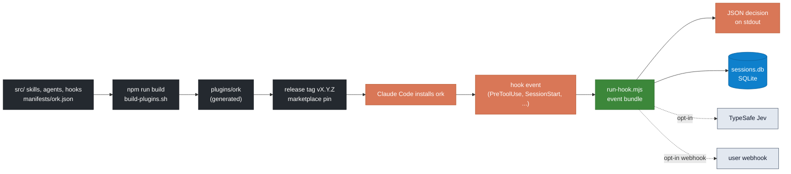
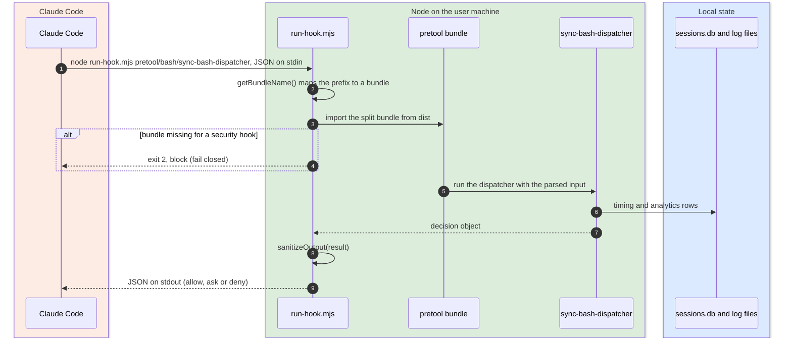
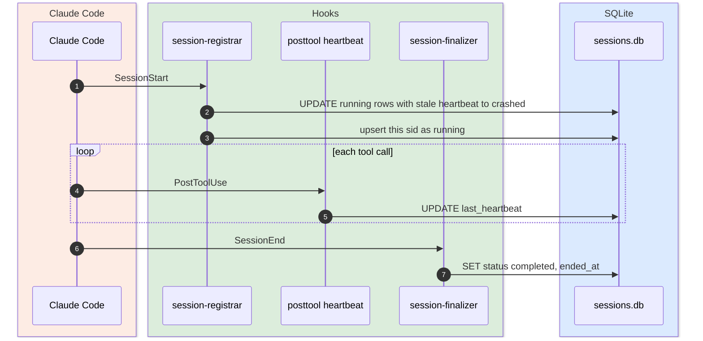
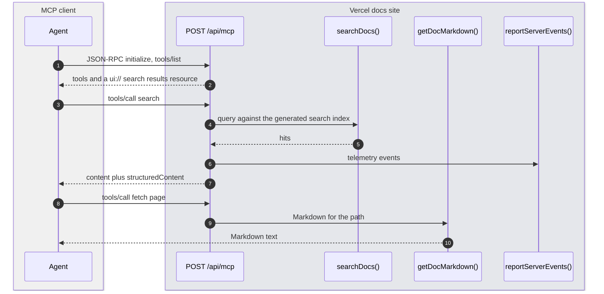
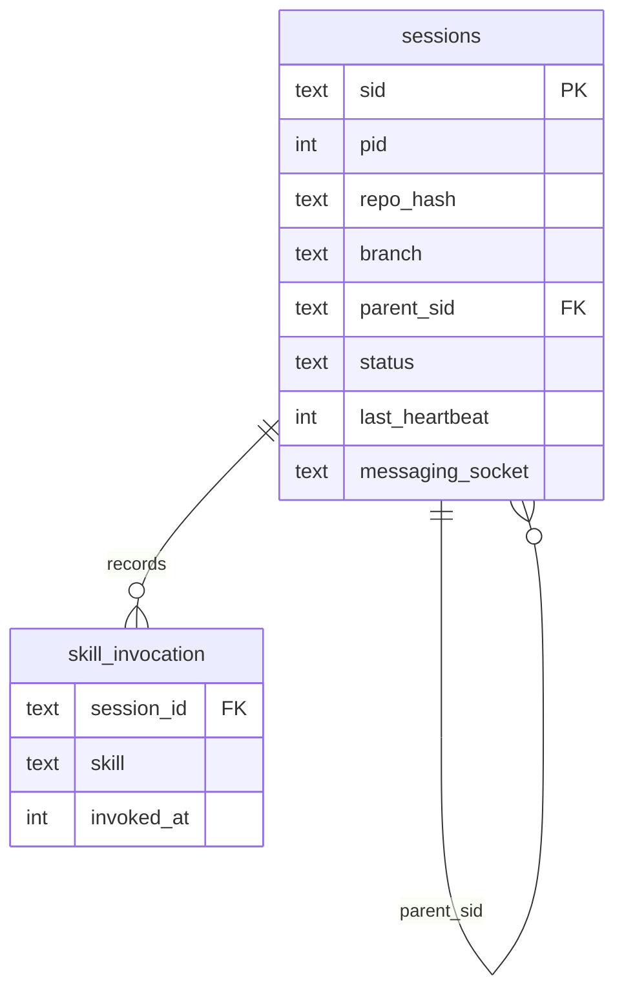
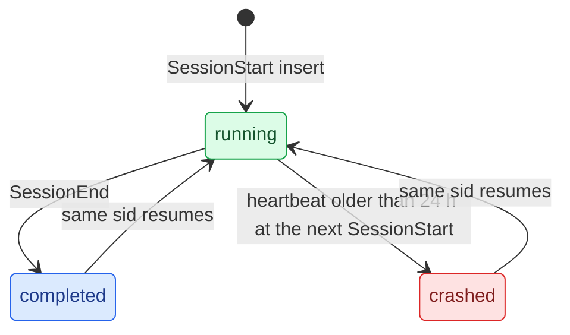

# orchestkit architecture

Read at: `yonatangross/orchestkit@d21e50af2957818c3919901faf2f507b7f8e997d` (main, release 10.10.1) on 2026-11-06 · Last verified: 2026-11-06 by an architecture docs pass

Every `file:line` tag below is at that sha. VERIFIED means the file or command was read at that sha; CLAIMED means it was not.

## Where each diagram renders

| Diagram | Source in the repo | On GitHub | On the preview page |
|---|---|---|---|
| Component graph | `docs/architecture/orchestkit-components.mmd` (architecture-beta, `hq` icon pack) | exported SVG `docs/architecture/orchestkit-components.svg` (GitHub mermaid loads no icon packs) | live mermaid with icons |
| Deploy pipeline | `docs/architecture/orchestkit-deploy.mmd` (flowchart with icon nodes) | exported SVG `docs/architecture/orchestkit-deploy.svg` | live mermaid with icons |
| Data flow, sequences, ER, lifecycles | inline mermaid below | native mermaid, brand colors via `classDef` and `box` | live mermaid |
| Icon pack | `docs/architecture/hq-icons.json` (iconify logos, simple-icons, mdi, plus brand-color monograms) | used by the SVG export | loaded by the page |

Regenerate the SVGs from the repo root: `npx -y @mermaid-js/mermaid-cli@12.2.0 -i docs/architecture/<name>.mmd -o docs/architecture/<name>.svg -b white --iconPacksNamesAndUrls "hq#file://$PWD/docs/architecture/hq-icons.json"`.
The page `docs/architecture/index.html` is generated from this file plus `page.json` and `services.json`.

## 1. Purpose

OrchestKit is a Claude Code plugin named `ork`: 115 skills, 36 agents and 163 hooks that a developer installs into Claude Code to plan, build, review and ship software. The source lives in `src/` and `manifests/`; `npm run build` assembles the installable plugin into `plugins/ork/`, and release tags pin the marketplace entry users install from. Next to the plugin the repo ships a public docs site (Next.js on Vercel) with a read-only docs MCP endpoint, a stdio copy of that MCP server as a container image, a Codex variant of the plugin, two small hook-contract libraries (npm and PyPI), a Python package and a Go SDK. Users are developers running Claude Code (and, for the exports, Codex, Cursor and Gemini). It is not a hosted service: the plugin runs on the developer's machine, and the only server pieces are the docs site and its API.
VERIFIED `CLAUDE.md:19-36`, `manifests/ork.json:4`, `src/hooks/hooks.json:2` (151 global + 12 skill-scoped = 163), `package.json:10`, `server.json:13-27`, `Dockerfile:1-9`. Counts VERIFIED by `ls -d src/skills/*/` (115) and `ls src/agents/*.md` (37 files, one is `README.md`).

## 2. Component graph

Source: `architecture/orchestkit-components.mmd`. Nodes and edges from `scripts/build-plugins.sh:15-17`, `.claude-plugin/marketplace.json:14-40`, `.github/workflows/release.yml:14-17,176,293,437`, `src/hooks/bin/run-hook.mjs:405-412`, `src/hooks/src/lib/session-registry.ts:112`, `src/hooks/src/lib/session-category-provider.ts:53`, `docs/site/app/api/mcp/route.ts:58,87`, `docs/site/lib/search-autocomplete.ts:221`, `docs/site/lib/posthog-mirror.ts:21`. Registries (npm, PyPI, GHCR, MCP registry) are in the deploy pipeline, not here. WAHA and Prodigi are not drawn (see Risks).

## 3. Data flow (from source to a running hook)

Legend: dark GitHub build side, orange Claude Code, green Node hook runner, blue SQLite, grey opt-in outside calls. Brand colors are approximate (CLAIMED).
Source: `package.json:10`, `scripts/build-plugins.sh:15-17`, `.claude-plugin/marketplace.json:14-30`, `src/hooks/hooks.json:3-20`, `src/hooks/bin/run-hook.mjs:77,405,927`, `src/hooks/src/lib/session-registry.ts:112`, `src/hooks/src/lib/session-category-provider.ts:49,53`, `src/hooks/bin/telemetry-sync.mjs:127-144`.

## 3b. Services inventory

Every external service and tool this repo touches, grouped by category. Wired = VERIFIED `file:line`. Plan = unknown for every paid service: no file in the repo records a plan, and no cost figures are copied here. Free, open source and built-in tools say so. Owner = maintainer for every row (CLAIMED: CODEOWNERS names one owner for the whole repo, no per-service owner).

28 live services and tools, 0 retired wired (WAHA appears only as skill teaching content, see Risks).

**AI**

| Service | Used for | Wired in | Plan | Owner |
|---|---|---|---|---|
| Claude Code | The host the plugin runs in; also `claude -p` in CI triage | `src/hooks/hooks.json:3-20`; `.github/workflows/ci-sentinel.yml:78` | unknown | maintainer (CLAIMED) |
| Anthropic API | Publishing skills through the Skills API | `scripts/publish-skills.mjs:79,233` | unknown | maintainer (CLAIMED) |
| TypeSafe (Jev) | Opt-in session category cascade in hooks; opt-in rerank on the docs site | `src/hooks/src/lib/session-category-provider.ts:49,53`; `docs/site/lib/jev-rerank.ts:67` | unknown | maintainer (CLAIMED) |
| OpenAI API | Search autocomplete on the docs site | `docs/site/lib/search-autocomplete.ts:221,239` | unknown | maintainer (CLAIMED) |

**Data**

| Service | Used for | Wired in | Plan | Owner |
|---|---|---|---|---|
| SQLite (node:sqlite) | Local session registry shared by all sessions on one machine | `src/hooks/src/lib/session-registry.ts:52,112` | built in to Node | maintainer (CLAIMED) |

**Content**

| Service | Used for | Wired in | Plan | Owner |
|---|---|---|---|---|
| Fumadocs + Next.js | The docs site, MDX content, search index | `docs/site/package.json`; `docs/site/source.config.ts` | open source | maintainer (CLAIMED) |
| IndexNow | Daily URL submission for search engines | `docs/site/app/api/indexnow/route.ts:19`; `docs/site/vercel.json:14` | free | maintainer (CLAIMED) |

**Infra**

| Service | Used for | Wired in | Plan | Owner |
|---|---|---|---|---|
| Vercel | Hosts the docs site, deploys `main` only, runs the IndexNow cron | `docs/site/vercel.json:3-14`; `vercel.json:3` | unknown | maintainer (CLAIMED) |
| GitHub | Source, releases, the marketplace pin, the dist repo mirror | `.claude-plugin/marketplace.json:14-30`; `.github/workflows/release.yml:122,293` | unknown | maintainer (CLAIMED) |
| GHCR | Docs MCP stdio image, multi-arch | `Dockerfile:18-31`; `.github/workflows/release.yml:437-457` | included with GitHub | maintainer (CLAIMED) |
| npm registry | `@orchestkit/hook-contract` with provenance | `.github/workflows/publish-hook-contract-npm.yml:225,270` | free, public | maintainer (CLAIMED) |
| PyPI and TestPyPI | `orchestkit` and `orchestkit-hook-contract` Python packages | `.github/workflows/publish-orchestkit-py.yml:100-135` | free, public | maintainer (CLAIMED) |
| MCP registry | Lists the docs MCP server (remote and OCI) | `server.json:1-27`; `.github/workflows/release.yml:492` | free | maintainer (CLAIMED) |
| Go module proxy | `github.com/yonatangross/orchestkit/sdk` Go client | `sdk/go.mod:1`; `.github/workflows/go-sdk.yml` | free | maintainer (CLAIMED) |
| Docker | Builds and runs the docs MCP image | `Dockerfile:18,26`; `.github/workflows/docker-smoke.yml` | n/a | maintainer (CLAIMED) |

**Observability**

| Service | Used for | Wired in | Plan | Owner |
|---|---|---|---|---|
| PostHog | Mirror of docs site product events through a same-origin proxy | `docs/site/instrumentation-client.ts:1-20`; `docs/site/lib/posthog-mirror.ts:21`; `docs/site/next.config.mjs:40-50` | unknown | maintainer (CLAIMED) |
| First-party analytics | Docs site analytics, the system of record | `docs/site/app/api/analytics/route.ts:1`; `docs/site/app/layout.tsx:121` | n/a | maintainer (CLAIMED) |
| User webhook | Opt-in hook telemetry batch upload to a URL the user sets | `manifests/ork.json:36,42`; `src/hooks/bin/telemetry-sync.mjs:127-144` | user-owned | user (CLAIMED) |

**CI**

| Service | Used for | Wired in | Plan | Owner |
|---|---|---|---|---|
| GitHub Actions | 58 workflows: tests, validation, release, publish | `.github/workflows/ (58 files)` | unknown | maintainer (CLAIMED) |
| release-please | Release PRs and version tags from conventional commits | `.github/workflows/release-please.yml:77`; `.release-please-manifest.json` | open source | maintainer (CLAIMED) |
| gitleaks | Secret scanning in CI | `.github/workflows/ci.yml:419-421` | open source | maintainer (CLAIMED) |
| CodeQL | Code scanning | `.github/workflows/codeql.yml:33` | free for public repos | maintainer (CLAIMED) |
| OpenSSF Scorecard | Supply chain score | `.github/workflows/scorecard.yml:34` | free | maintainer (CLAIMED) |
| zizmor | Workflow security lint | `.github/zizmor.yml`; `.github/workflows/validate-workflows.yml` | open source | maintainer (CLAIMED) |
| Dependabot | Dependency bumps, auto-merge for safe ones | `.github/dependabot.yml`; `.github/workflows/dependabot-automerge.yml` | free | maintainer (CLAIMED) |

**Tooling**

| Service | Used for | Wired in | Plan | Owner |
|---|---|---|---|---|
| Codex plugin export | `plugins/ork-codex` built from `src/codex/ork-codex` | `scripts/build-codex-plugin.sh:6-7`; `manifests/codex/ork-codex.json` | n/a | maintainer (CLAIMED) |
| Cursor export | Command wrappers and rules for Cursor | `scripts/_cursor-export.py:2-4` | n/a | maintainer (CLAIMED) |
| Gemini skills export | Chosen skills zipped for the Gemini app | `scripts/export-gemini-skills.mjs:2` | n/a | maintainer (CLAIMED) |

## 4. Components

| Component | Path | What it does | Runs where | Tag |
|---|---|---|---|---|
| Skills | `src/skills/<name>/SKILL.md` | 115 skills, surfaced as `/ork:<name>` | Claude Code, user machine | VERIFIED `CLAUDE.md:27,80` |
| Agents | `src/agents/<name>.md` | 36 subagent definitions | Claude Code | VERIFIED `CLAUDE.md:28`, file count |
| Hooks | `src/hooks/` (TypeScript, esbuild split bundles) | 151 global + 12 skill-scoped hooks across 32 events | Node on the user machine | VERIFIED `src/hooks/hooks.json:2`, event count by JSON parse |
| Hook runner | `src/hooks/bin/run-hook.mjs` | Reads stdin, loads the event bundle, runs the hook, sanitizes and prints the JSON result | Node | VERIFIED `run-hook.mjs:77,405,927` |
| Session registry | `src/hooks/src/lib/session-registry.ts` | SQLite file in a per-user state directory, shared by all sessions | user machine | VERIFIED `session-registry.ts:112` |
| Workflows | `manifests/ork.json` `workflows` | 8 Workflow tool scripts (review fan-out, verify dispatch, and more) | Claude Code | VERIFIED `manifests/ork.json:25-34` |
| Build | `scripts/build-plugins.sh` | Assembles `plugins/ork` from `src/` and `manifests/` | developer machine, CI | VERIFIED `build-plugins.sh:15-17`, `package.json:10` |
| Codex plugin | `src/codex/ork-codex` to `plugins/ork-codex` | Codex variant: hooks, profiles, roles, skills | Codex on the user machine | VERIFIED `build-codex-plugin.sh:6-7` |
| Docs site | `docs/site/` | Next.js 16 + Fumadocs, 352 content files, `/api` routes (mcp, search, ask, md, og, well-known) | Vercel | VERIFIED `docs/site/package.json`, `docs/site/vercel.json:3-14` |
| Docs MCP (HTTP) | `docs/site/app/api/mcp/route.ts` | Stateless JSON-RPC MCP: docs search and Markdown fetch | Vercel | VERIFIED `route.ts:8-13,58,87,160` |
| Docs MCP (stdio) | `src/mcp-server/` | Same tools over stdio; tool calls fetch the public docs API | Docker image on GHCR | VERIFIED `Dockerfile:1-9,18-31` |
| CLI | `packages/cli` (npm `orchestkit`) | MCP config helper pointing at the docs MCP | user machine | VERIFIED `packages/cli/src/mcp-config.ts:2` |
| Hook contract | `packages/hook-contract`, `packages/hook-contract-py` | Typed hook input and output contract for TS and Python | npm, PyPI | VERIFIED package manifests |
| Python package | `packages/orchestkit-py` | `orchestkit` on PyPI | PyPI | VERIFIED `pyproject.toml` name |
| Go SDK | `sdk/` | Go client | Go module | VERIFIED `sdk/go.mod:1` |
| Jev shadow | `packages/jev-shadow` | Private workspace package for Jev shadow reports | CI, local | VERIFIED `package.json` private true |
| Mods | `mods/` | 5 interface mods (lesson-cards, memory-lens, promote-lights, prompt-enhancer, secrets-veil) | Claude Code | CLAIMED (dir names only) |

Size at this sha: 58 workflows, 32 hook events, 352 docs content files. VERIFIED `git ls-tree -r` counts and a JSON parse of `src/hooks/hooks.json`.

## 5. Key flows

### 5.1 A PreToolUse hook on a Bash call

Source: `src/hooks/hooks.json:3-20`, `src/hooks/bin/run-hook.mjs:77,232,405-412,477,484-497,927`.

### 5.2 Session registration and heartbeat

Source: `src/hooks/src/lifecycle/session-registrar.ts:10-16,198-199,224-240`, `src/hooks/src/posttool/heartbeat.ts:47`, `src/hooks/src/lifecycle/session-finalizer.ts:7,35`.

### 5.3 An agent searches the docs over MCP

Source: `docs/site/app/api/mcp/route.ts:8-13,20-33,58,87,160,213`, `docs/site/lib/doc-search.ts:21`.

## 6. Data model

The repo owns one small local database: the session registry, `sessions.db`, created by the hooks with `node:sqlite` in a per-user state directory. Five migrations; 005 dropped three tables that never held a row.

Source: `src/hooks/src/lib/sqlite-migrations/001-initial.sql` (sessions), `002-skill-analytics.sql` (skill_invocation), `003-routing-edges.sql` (view `routing_edge` over skill_invocation, not a table), `004-messaging-socket.sql`, `005-drop-unused-tables.sql` (drops locks, settings_overrides, worktree_links). The ER uses theme colors only, so it renders on GitHub.

## 7. Lifecycles

### 7.1 Session row status

Source: there is no enum; the three values are string literals in SQL. States VERIFIED `session-registrar.ts:198-199,230,240`, `session-finalizer.ts:35`. Edges VERIFIED from those statements: the insert is `ON CONFLICT(sid) DO UPDATE SET status = 'running'`, so a resumed sid goes back to running (`session-registrar.ts:233-240`). Legend: green live, blue ended cleanly, red crashed.

## 8. External dependencies and services

| Dependency | Kind | Wired in | Tag |
|---|---|---|---|
| Claude Code >= 2.1.277 | host runtime | `CLAUDE.md:84` | VERIFIED |
| Node 24 | runtime for hooks and build | `package.json:65-67`; `Dockerfile:18` | VERIFIED |
| node:sqlite | embedded database | `session-registry.ts:15-20,52` | VERIFIED |
| Vercel | docs site host | `docs/site/vercel.json:3-14` | VERIFIED |
| GitHub, GHCR, npm, PyPI, MCP registry | registries | see section 3b | VERIFIED |
| TypeSafe API, OpenAI API, PostHog | opt-in or site-only APIs | see section 3b | VERIFIED |

## 9. Deploy pipeline

Source: `architecture/orchestkit-deploy.mmd`, built from `.github/workflows/ci.yml:3-12`, `release-please.yml:27-37,77`, `release.yml:14-21,31,122,152,176,293,437,492`, `publish-hook-contract-npm.yml:40-42,270`, `publish-orchestkit-py.yml:4-6,115,135`, `docs/site/vercel.json:3-14`. The green hexagon is the required-check gate.

- Required checks on `main`: 23 contexts, including Build, Security Tests, Secret Scanning, TypeScript Tests (4 shards), CC Plugin Validate, Manifests and Schemas, Docs Site Build and the standards gate. VERIFIED `gh api repos/yonatangross/orchestkit/branches/main/protection` on 2026-11-06. Required approving reviews: 0.
- What carries a release: release-please opens a release PR on `main`; merging it tags `vX.Y.Z`; `release.yml` creates the GitHub release with build provenance, opens the stable pin PR for the `ork` marketplace entry, syncs `plugins/ork` to the dist repo, pushes the docs MCP image to GHCR and publishes to the MCP registry. VERIFIED `release.yml:31,152,158-161,176,277-298,437,492`.
- The `ork-alpha` marketplace entry tracks `main` ahead of the stable pin. VERIFIED `.claude-plugin/marketplace.json:31-40`.
- Docs site: Vercel git deploys `main` only. VERIFIED `docs/site/vercel.json:3-7`, root `vercel.json:3`.
- Packages publish on their own tags (`hook-contract-npm/v*`, `hook-contract-py/v*`, `orchestkit-py/v*`). VERIFIED workflow headers.
- Rollback: CLAIMED, not read. No rollback runbook was found; the stable pin PR is the lever a user sees, since the `ork` entry pins a tag.

## 10. Secrets

Names only. Values never appear here. Secrets live in GitHub Actions secrets and, for the docs site, in the Vercel project environment; a secret manager holds the source copies (CLAIMED).

| Variable | Reference | Used by | Tag |
|---|---|---|---|
| RELEASE_BOT_APP_ID, RELEASE_BOT_PRIVATE_KEY | GitHub Actions secret | release, dist sync, pin PR, autobuild | VERIFIED `.github/workflows/claude-release-watch.yml:449-450`, `release.yml:337-345` |
| CLAUDE_CODE_OAUTH_TOKEN | GitHub Actions secret | `claude -p` in CI triage and sentinel | VERIFIED `.github/workflows/ci-sentinel.yml:78-83` |
| ANTHROPIC_API_KEY | GitHub Actions secret, local env | ultrareview workflow, `publish-skills.mjs` | VERIFIED `.github/workflows/ultrareview.yml:74`, `scripts/publish-skills.mjs:233` |
| ORK_EVALS_API_KEY | GitHub Actions secret | plugin eval score | VERIFIED `.github/workflows/plugin-eval-score.yml:46` |
| NPM_TOKEN | GitHub Actions secret | docs workflow | VERIFIED `.github/workflows/docs.yml:232` |
| YG_PYPI_INDEX_URL | GitHub Actions secret | memory staleness job (private package index) | VERIFIED `.github/workflows/memory-staleness.yml:61` |
| TYPESAFE_API_KEY | Vercel env | docs site Jev rerank | VERIFIED `docs/site/lib/jev-rerank.ts:67` |
| OPENAI_API_KEY | Vercel env | docs site autocomplete | VERIFIED `docs/site/lib/search-autocomplete.ts:239` |
| ORK_TYPESAFE_API_KEY | user env | opt-in Jev in hooks | VERIFIED `src/hooks/src/lib/jev-key.ts:2` |
| CLAUDE_PLUGIN_OPTION_HOOKTOKEN | plugin user config | opt-in telemetry webhook | VERIFIED `src/hooks/bin/telemetry-sync.mjs:128`, `manifests/ork.json:42` |

npm and PyPI publishing use OIDC trusted publishing, not a stored token. VERIFIED `publish-hook-contract-npm.yml:23,270`, `publish-orchestkit-py.yml:115,135`. Source of truth for the CI list: `git grep secrets\. .github/workflows` (11 names incl. GITHUB_TOKEN; HQ_API_URL and HQ_API_TOKEN appear only in a commented-out step in `claude-health.yml:190-200`).

## 11. Owners, risks, verification

- Owners in the repo: `* @yonatangross`, with `.github/`, `src/hooks/`, `manifests/` and `CLAUDE.md` called out. VERIFIED `.github/CODEOWNERS:5-11`.
- Owners outside the repo: the maintainer. CLAIMED.
- Open risks:
  1. **CLAUDE.md says `main` and `dev` are protected (`CLAUDE.md:62`), but `dev` does not exist.** `gh api .../branches/dev/protection` returns 404 "Branch not found" (VERIFIED 2026-11-06). Workflows still list `dev` in their branch filters (`ci.yml:5,7`, `docs.yml:8,32`). Contributors may target a branch that is not there.
  2. **Generated `plugins/` is committed.** A source edit without `npm run build` drifts from what users install; CI guards it (`plugin-validation.yml`, `counts-validation`), and `hooks/dist/` is release-owned. VERIFIED `CLAUDE.md:32,36`.
  3. **A missing hook bundle blocks.** Security hooks fail closed when their bundle cannot load (`run-hook.mjs:232,477,484-497`). Safe by design, but a broken install stops tool calls until rebuilt.
  4. **Counts are stamped in many places.** `manifests/ork.json:4` and `marketplace.json` say 36 agents and 163 hooks; `marketplace.json` description still says 43 commands. A count change needs `bin/validate-counts.sh`. VERIFIED `CLAUDE.md:58`, `.claude-plugin/marketplace.json:5`.
  5. **`docs/coordination-architecture.md` describes tables dropped in migration 005** (locks, settings_overrides, worktree_links; 4 matching lines). Read it as history for those tables.
  6. **WAHA (retired): leftover only as teaching content.** 73 matching lines in 21 files, all in the `api-design` skill (source and its generated copies, for example `src/skills/api-design/references/whatsapp-waha.md`, `src/skills/api-design/rules/messaging-integrations.md`) and docs site generated data. Nothing wires it. VERIFIED `git grep -n -i -I waha d21e50af2 | wc -l`. Prodigi: 0 matches.
- What this doc did not check: the docs site `/api/ask` model path, `/api/jobs`, the well-known routes, mods internals, the Codex runtime, the Go SDK API surface, eval workflows, whether the MCP registry entry is live, Vercel project settings, and any runtime state.

## 12. Related docs

| Doc | What it covers | State |
|---|---|---|
| `CLAUDE.md`, `AGENTS.md` | Repo map, commands, adding components | current (see risk 1) |
| `src/hooks/README.md` | Hook architecture and registry changelog | not re-read |
| `docs/coordination-architecture.md` | SQLite coordination layer (M168) | partly stale, see risk 5 |
| `docs/adr/optional-agent-identity.md` | OAuth discovery and the 401 hint on the docs API | accepted 2026-09-14 |
| `docs/adr/caching-strategy.md`, `docs/adr/database-selection.md` | Example ADRs, not about this repo's own system | proposed, out of scope |
| `src/skills/CONTRIBUTING-SKILLS.md`, `CONTRIBUTING.md` | Skill authoring standards, release cadence | not re-read |
| `.github/workflows/README.md` | Workflow index | not re-read |
