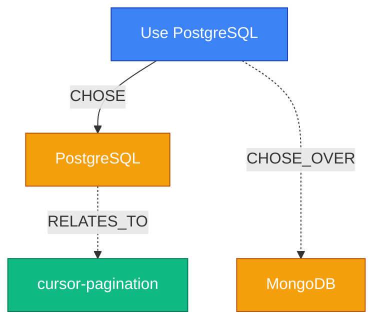
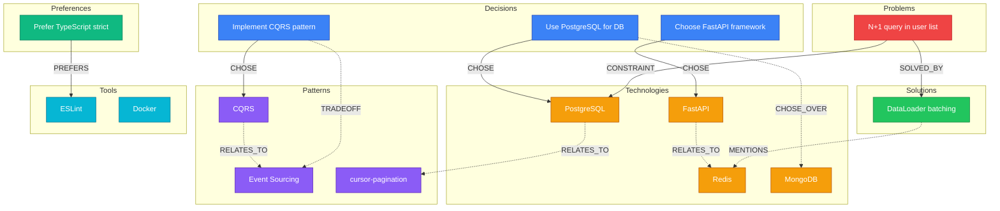
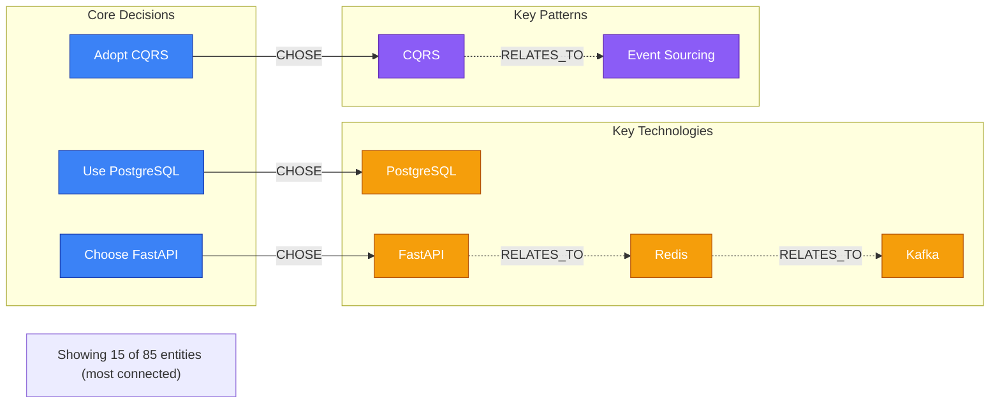

<span className="badge badge-blue">Command</span> <span className="badge badge-yellow">medium</span>

```bash title="Invoke"
/ork:memory
```

<ContextualSkillSidebar slug="memory" />

> **Memory** Memory in three verbs: remember (store a decision or pattern), search (search, load, history, viz, status) and dream (consolidate stale memory files). Use when storing, finding or cleaning up what was learned or decided.


# Memory - Remember, Search, Dream

Three verbs: `remember` (store, "Verb: remember" below), `search` (read, the subcommands below), `dream` (consolidate, `Read("references/verb-dream.md")`). Formerly the skills `remember` and `dream`: `/ork:remember` is now `/ork:memory remember`.

> **Cross-session read strategy (Opus 5.5 / CC 2.1.111+):** Opus 5.5 reads filesystem memory reliably across sessions. When loading context at session start, prefer the layered read order:
> 1. `~/.claude/projects/<slug>/memory/MEMORY.md` (durable index, load first, always)
> 2. `.claude/chain/state.json` + most recent `NN-*.json` handoff (session continuation)
> 3. MCP `mcp__memory__search_nodes` for anything the filesystem index doesn't answer (typed graph traversal)
>
> Layer 1 is cheap (small index file), Layer 2 is scoped (session-specific), Layer 3 is selective (only when needed). Avoid dumping the full knowledge graph into context, use the index to narrow the search first.

## Argument Resolution

```python
SUBCOMMAND = "$ARGUMENTS[0]"  # First token: remember, dream, or search, load, history, viz, status
QUERY = "$ARGUMENTS[1]"       # Second token onward: search query, text to remember, or flags
# $ARGUMENTS is the full string (CC 2.1.59 indexed access)
```

`remember`: follow "Verb: remember" below. `dream`: `Read("references/verb-dream.md")` (flag `--dry-run`). Anything else is a search subcommand.

## Usage

```bash
memory remember <text> # Store a decision or pattern (flags below)
memory dream            # Consolidate memory files (--dry-run)
memory search <query>  # Search knowledge graph
memory load             # Load context at session start
memory history          # View decision timeline
memory viz              # Visualize knowledge graph
memory status           # Show memory system health
```

---

## CRITICAL: Use AskUserQuestion When No Subcommand

With no verb, ask which one (`remember`, `search`, `dream`). For `search`, ask which subcommand:

```python
AskUserQuestion(
  questions=[{
    "question": "What memory operation do you need?",
    "header": "Operation",
    "options": [
      {"label": "search", "description": "Search decisions and patterns in knowledge graph"},
      {"label": "load", "description": "Load relevant context for this session"},
      {"label": "history", "description": "Decision timeline + knowledge-graph viz (--mermaid)"},
      {"label": "status", "description": "Check memory system health"}
    ],
    "multiSelect": false
  }]
)
```

---

## Subcommands

Load details: `Read("references/memory-commands.md")` for full usage, flags, output formats, and context-aware result limits for each subcommand.

| Subcommand | Purpose |
|------------|---------|
| `search` | Search past decisions, patterns, entities. Supports `--category` (maps to metadata.category), `--limit`, `--agent` (scopes by agent_id), `--global` filter flags |
| `load` | Auto-load relevant memories at session start. Supports `--project`, `--global` |
| `history` | Decision timeline with table, Mermaid, or JSON output. Supports `--since`, `--mermaid` |
| `viz` | Render knowledge graph as Mermaid diagram. See also `Read("references/mermaid-patterns.md")` |
| `status` | Memory system health check |

---

## Scheduled Sweeps (cron)

### Nightly KG staleness report

Cron job in `.github/workflows/memory-staleness.yml` runs nightly at 04:00 UTC. Calls `scripts/staleness_cron.py` to scan ALL memory MCP entities, flag those whose latest observation timestamp is older than 30 days, and write a Markdown report to `docs/reports/memory-staleness-YYYY-MM-DD.md`.

```bash
python3 ${CLAUDE_SKILL_DIR}/scripts/staleness_cron.py docs/reports/ \
    --threshold-days 30 --limit 50
```

Auto-skip conditions (exit 0 and WARN-logged on a local run; with `--require-read`, which the nightly workflow passes, exit 3 and status `unknown`). An unreadable `search_nodes` answer exits 2 in both modes:

| Skip reason | Trigger |
|-------------|---------|
| `yg-mcp-core not importable` | `yg-mcp-core>=0.3.0` not installed (orchestkit is public; yg-mcp-core lives on private `pypi.yonyon.ai`, HQ-only) |
| `memory MCP unreachable` | memory MCP server down OR `.mcp.json` doesn't define `memory` |

**Report contents:**
- Total / stale / fresh entity counts
- Top N stale entries sorted by staleness (no-timestamp first, then oldest → newest)
- Each row: name, entityType, age in days, observations count
- Suggested actions per age bucket (>90d review, >180d archive candidate)

**Treats entities with no parsable timestamp as stale**: operator intervention is the right outcome (backfill `last_read` observation OR prune).

Pure helpers (`parse_iso_timestamp`, `latest_observation_timestamp`, `is_stale`, `build_report_payload`, `render_markdown`) live in sibling `staleness_lib.py` for unit-testability.

Mirrors `Yonatan-HQ/hq-ext-plugin#194` (audio_podcast) and orchestkit#1886 (post-synth podcast) + #1887 (memory writeback) pattern. Unblocked by `Yonatan-HQ/core#993` (yg-mcp-core 0.3.0).

---

## Workflow

### 1. Parse Subcommand
```
Extract first argument as subcommand
If no subcommand -> AskUserQuestion
Validate subcommand is one of: remember, dream, search, load, history, viz, status
Parse remaining flags
Check for --agent <agent-id> flag → agent_id: "ork:{agent-id}"
```

### 2. Execute Subcommand
Route to appropriate handler based on subcommand.

### 3. Report Results
Format output appropriate to the operation.

---

## Rules Quick Reference

| Rule | Impact | What It Covers |
|------|--------|----------------|
| entity-extraction-patterns (load `rules/entity-extraction-patterns.md`) | HIGH | Entity types, relation types, graph query semantics |
| deduplication-strategy (load `rules/deduplication-strategy.md`) | HIGH | Edit-over-Write pattern, anchor-based insertion, verification |
| remember rules (load `rules/duplicate-entity-detection.md`, `entity-relationship-validation.md`, `observation-quality-gate.md`) | HIGH | Search before create, allowed entity and relation types, observations need a metric or condition |

---

## Session Resume

Load details: `Read("references/session-resume-patterns.md")` for CC 2.1.31 resume hints, context capture before ending, and resume workflows for PRs, issues, and implementations.

---

## Verb: remember (store decisions and patterns)

> **Filesystem vs MCP memory (Opus 5.5 guidance, CC 2.1.111+):** Opus 5.5 reads filesystem memory reliably across multi-session work. Use that to your advantage:
> - **Short-lived handoff state** (current phase, task in-progress, pending approvals) → `.claude/chain/*.json` files. Small, structured, session-scoped.
> - **Durable auto-memory** (user facts, feedback, project conventions) → `~/.claude/projects/<slug>/memory/*.md` files with a one-line index in `MEMORY.md`. Read on every session start.
> - **Cross-session knowledge graph** (typed entities + relations for query traversal) → MCP memory server (this skill's default path). Best when future sessions will *search* for patterns.
>
> The three are complementary, not alternatives. Prefer fs for anything you'd want to grep; prefer MCP for anything you'd want to traverse.

Store important decisions, patterns, or context in the knowledge graph for future sessions. Supports tracking success/failure outcomes for building a Best Practice Library.

### Argument Resolution

```python
TEXT = "$ARGUMENTS"        # Full argument string; drop the leading `remember` token, e.g., "We use cursor pagination"
FLAG = "$ARGUMENTS[1]"     # Token after `remember` — check for --success, --failed, --category, --agent
# $ARGUMENTS[0] is the verb; flags start at $ARGUMENTS[1] (CC 2.1.59 indexed access)
# Remaining tokens after flags = the text to remember
```

### Architecture

The remember verb uses **knowledge graph** as storage:

1. **Knowledge Graph**: Entity and relationship storage via `mcp__memory__create_entities` and `mcp__memory__create_relations`. These tools come from a `memory` MCP server that OrchestKit does not bundle: configure one in the user or project scope first (for example `@modelcontextprotocol/server-memory`) and confirm it with `claude mcp list`. Without it, every graph step here does nothing.

**Benefits:**
- Free and local once the memory server is configured
- Explicit relationship queries (e.g., "what does X use?")
- Cross-referencing between entities
- No cloud dependency

**Automatic Entity Extraction:**
- Extracts capitalized terms as potential entities (PostgreSQL, React, pgvector)
- Detects agent names (database-engineer, backend-system-architect)
- Identifies pattern names (cursor-pagination, connection-pooling)
- Recognizes "X uses Y", "X recommends Y", "X requires Y" relationship patterns

### Usage

#### Store Decisions (Default)
```
remember <text>
remember --category <category> <text>
remember --success <text>     # Mark as successful pattern
remember --failed <text>      # Mark as anti-pattern
remember --success --category <category> <text>

# Agent-scoped memory
remember --agent <agent-id> <text>         # Store in agent-specific scope
remember --global <text>                   # Store as cross-project best practice
```

### Flags

| Flag | Behavior |
|------|----------|
| (default) | Write to graph |
| `--success` | Mark as successful pattern |
| `--failed` | Mark as anti-pattern |
| `--category <cat>` | Set category |
| `--agent <agent-id>` | Scope memory to a specific agent |
| `--global` | Store as cross-project best practice |

### Categories

- `decision` - Why we chose X over Y (default)
- `architecture` - System design and patterns
- `pattern` - Code conventions and standards
- `blocker` - Known issues and workarounds
- `constraint` - Limitations and requirements
- `preference` - User/team preferences
- `pagination` - Pagination strategies
- `database` - Database patterns
- `authentication` - Auth approaches
- `api` - API design patterns
- `frontend` - Frontend patterns
- `performance` - Performance optimizations

### Outcome Flags

- `--success` - Pattern that worked well (positive outcome)
- `--failed` - Pattern that caused problems (anti-pattern)

If neither flag is provided, the memory is stored as neutral (informational).

### Workflow

#### 1. Parse Input

```
Check for --success flag → outcome: success
Check for --failed flag → outcome: failed
Check for --category <category> flag
Check for --agent <agent-id> flag → agent_id: "ork:{agent-id}"
Check for --global flag → use global user_id
Extract the text to remember
If no category specified, auto-detect from content
```

#### 2. Auto-Detect Category

| Keywords | Category |
|----------|----------|
| chose, decided, selected | decision |
| architecture, design, system | architecture |
| pattern, convention, style | pattern |
| blocked, issue, bug, workaround | blocker |
| must, cannot, required, constraint | constraint |
| pagination, cursor, offset, page | pagination |
| database, sql, postgres, query | database |
| auth, jwt, oauth, token, session | authentication |
| api, endpoint, rest, graphql | api |
| react, component, frontend, ui | frontend |
| performance, slow, fast, cache | performance |

#### 3. Extract Lesson (for anti-patterns)

If outcome is "failed", look for:
- "should have", "instead use", "better to"
- If not found, prompt user: "What should be done instead?"

#### 4-6. Extract Entities and Create Graph

Extract entities (Technology, Agent, Pattern, Project, AntiPattern) from the text, detect relationship patterns ("X uses Y", "chose X over Y", etc.), then create entities and relations in the knowledge graph.

#### 7. Confirm Type + Scope (AskUserQuestion: M118 #1466)

Auto-classification is best-effort. Before writing, ask the user to confirm both the memory type and the persistence scope. Pre-select the auto-detected type as the default option when the classifier is confident (≥0.9):

```python
# Skip when the invocation already specifies type and scope:
#   remember --type=preference --global  → skip, use those values
#   remember --session  → skip, no persistence
#
# Otherwise, ask both:
AskUserQuestion(questions=[
  {"question": "What type of memory?",
   "header": "Type",
   "options": [
     {"label": "Preference", "description": "How I like to work (style, format, tooling)"},
     {"label": "Project fact", "description": "State of THIS codebase (decisions, constraints)"},
     {"label": "Reference", "description": "External system pointer (URL, doc, dashboard)"},
     {"label": "Feedback", "description": "Correction to future behavior — applied as a rule"}
   ]},
  {"question": "Apply to?",
   "header": "Scope",
   "options": [
     {"label": "This project (default)", "description": "Scoped to .claude/projects/<this-project>/memory/"},
     {"label": "All projects (global)", "description": "User-level memory at ~/.claude/memory/"},
     {"label": "This session only", "description": "Print to context but don't persist"}
   ]}
])
```

**Default selection rules:**
- If auto-detected category maps to one of the 4 type options with confidence ≥0.9, that option is pre-selected (the user can still override).
- "This project" is always the scope default.
- "This session only" returns immediately without writing, useful when the user wants to surface a fact for the conversation but not commit it.

**Global memory writes** route to `~/.claude/memory/<filename>.md` instead of the project-local memory directory. The MEMORY.md index is updated in whichever scope was selected (project- or user-level).

Load entity extraction rules, type assignment, relationship patterns, and graph creation examples: `Read("references/graph-operations.md")`

#### 7. Confirm Storage

Display confirmation using the appropriate template (success, anti-pattern, or neutral) showing created entities, relations, and graph stats.

Load output templates and examples: `Read("references/confirmation-templates.md")`

### File-Based Memory Updates

When updating `.claude/memory/MEMORY.md` or project memory files:
- **PREFER Edit over Write** to preserve existing content and avoid overwriting
- Use stable anchor lines: `## Recent Decisions`, `## Patterns`, `## Preferences`
- See `rules/deduplication-strategy.md` (Edit over Write) for the full Edit pattern
- This applies to the calling agent's file operations, not to the knowledge graph operations above

---

## References

Load on demand with `Read("references/<file>")`:

| File | Content |
|------|---------|
| `verb-dream.md`, `housekeeping.md`, `index-budget.md`, `safe-deletes.md` | Dream: the full verb, housekeeping, MEMORY.md budget, safe deletes |
| `category-detection.md`, `graph-operations.md`, `confirmation-templates.md`, `entity-extraction-workflow.md`, `examples.md` | Remember: category rules, graph operations, output templates, extraction, examples |
| `memory-commands.md`, `mermaid-patterns.md`, `session-resume-patterns.md` | Search: subcommands, Mermaid, resume |

---

## Error Handling

- If graph empty for viz: Show helpful message about using the remember verb
- If subcommand invalid: Show usage help
- If memory files corrupt: Report and offer repair
- If search query empty: Show recent entities instead
- If no search results: Suggest alternatives
- Remember: knowledge graph unavailable -> show configuration instructions
- Remember: empty text -> ask user for content; text >2000 chars -> truncate with notice
- Remember: both --success and --failed -> ask user to clarify
- Remember: entity extraction fails -> create generic Decision entity; relation fails -> create entities first, retry


---

## Rules (5)

### Deduplication Strategy: MEDIUM


# Deduplication Strategy

When loading or searching memories, prevent duplicate context injection.

## Rules

1. **Edit over Write**: When updating `.claude/memory/MEMORY.md` or project memory files, prefer `Edit` over `Write` to preserve existing content and avoid accidental overwrites.

2. **Anchor-based insertion**: Always verify the target section header exists before inserting:
   - `## Recent Decisions`
   - `## Patterns`
   - `## Preferences`
   - `## Detailed Notes`

3. **Surgical edits**: Use `Edit(file_path, old_string=anchor_line, new_string=anchor_line + "\n" + new_content)` to append under a section header without overwriting the rest.

4. **Verify after edit**: Always `Read(file_path)` after editing to confirm the edit applied correctly.

**Incorrect:**
```python
# Overwrite entire file — loses existing memories
Write(file_path=".claude/memory/MEMORY.md", content="## New Decision\n- Use Redis")
```

**Correct:**
```python
# Surgical edit — append under existing section header
Edit(file_path=".claude/memory/MEMORY.md",
     old_string="## Recent Decisions",
     new_string="## Recent Decisions\n- Use Redis for session caching (2026-03-01)")
```

## Why Edit Over Write

| Approach | Risk | Permission |
|----------|------|-----------|
| Write (overwrite) | Loses existing content if template incomplete | Requires approval |
| Edit (surgical) | Only modifies target section | Often auto-approved |

## Hook Exception

Hooks that need full file control use Node.js `writeFileSync` directly, this is correct for hooks context. The Edit pattern above is for agent-side SKILL.md operations.


### Search graph for existing entities before creating new ones to prevent duplicates: HIGH


## Problem

Creating entities without checking for existing ones leads to duplicate nodes in the knowledge graph. For example, "PostgreSQL", "postgres", and "Postgres" all become separate entities with separate relationships, splitting knowledge across fragments that are never linked.

## Rule

Before calling `mcp__memory__create_entities`, always call `mcp__memory__search_nodes` with the entity name. If a match shares 80%+ name similarity AND the same entity type, merge by adding observations to the existing entity instead of creating a new one.

### Detection Criteria

```
1. Normalize: lowercase, strip hyphens/underscores
2. Compare: Levenshtein distance or substring match
3. Match threshold: >= 80% similarity AND same entityType
4. Action: merge via add_observations if match found
```

### Incorrect: creating without search:

```json
// User says: "/ork:memory remember PostgreSQL handles our vector search"
// Agent immediately creates without checking:
mcp__memory__create_entities({
  "entities": [{
    "name": "PostgreSQL",
    "entityType": "Technology",
    "observations": ["Handles vector search"]
  }]
})
// Graph already had "postgres" (Technology) with 5 observations
// Now there are TWO entities for the same technology
```

### Correct: search first, merge if found:

```json
// Step 1: Search for existing entity
mcp__memory__search_nodes({ "query": "PostgreSQL" })
// Returns: { "name": "postgres", "entityType": "Technology", "observations": [...] }

// Step 2: 80%+ match found ("postgresql" vs "postgres") — merge
mcp__memory__add_observations({
  "observations": [{
    "entityName": "postgres",
    "contents": ["Handles vector search"]
  }]
})
// Single entity with all observations consolidated
```

### Edge Cases

- **Different entity types**: "react" (Technology) vs "react" (Pattern) are distinct, do not merge
- **Abbreviations**: "DB" vs "Database", treat as match only when context confirms same entity
- **Versioned names**: "React 18" vs "React", merge into parent entity, add version as observation

### Key Rules

- Always search before create, no exceptions
- Normalize names (lowercase, strip punctuation) before comparison
- Same name + same type at 80%+ similarity = merge via `add_observations`
- Different entity types with same name are distinct entities
- Inform user when merging: "Updated existing entity (added observation)"


### Entity Extraction Patterns: MEDIUM


# Entity Extraction Patterns

When searching or visualizing the knowledge graph, recognize these entity types and their typical observations.

## Entity Types

| Type | Examples | Typical Observations |
|------|----------|---------------------|
| `Technology` | pgvector, PostgreSQL, React | Version, use case, project association |
| `Agent` | database-engineer, backend-system-architect | Capabilities, scope, assigned tasks |
| `Pattern` | cursor-pagination, connection-pooling | When to use, trade-offs, implementation notes |
| `Decision` | "Use PostgreSQL for DB" | Rationale, alternatives considered, date |
| `Project` | Project-specific context | Stack, status, team, constraints |
| `AntiPattern` | Failed or abandoned patterns | Why it failed, what replaced it |
| `Constraint` | Budget, timeline, compliance | Source, severity, workarounds |
| `Preference` | "Prefer TypeScript strict" | Strength, scope, exceptions |

**Incorrect:**
```python
# Vague entity type, no useful observations
create_entities([{"name": "thing", "entityType": "misc", "observations": ["used it"]}])
```

**Correct:**
```python
# Specific type with actionable observations
create_entities([{"name": "pgvector", "entityType": "Technology",
    "observations": ["v0.7.0", "Used for RAG embeddings in acme-app", "Requires PostgreSQL 15+"]}])
```

## Relation Types

| Relation | Semantic | Arrow Style |
|----------|----------|-------------|
| USES | Active dependency | Solid |
| RECOMMENDS | Suggested approach | Solid |
| REQUIRES | Hard dependency | Solid |
| ENABLES | Unlocks capability | Solid |
| PREFERS | Stated preference | Solid |
| CHOSE_OVER | Rejected alternative | Dashed |
| USED_FOR | Purpose link | Solid |
| CONFLICTS_WITH | Incompatibility | Dashed |


### Validate entity types and relation types against the schema before writing to the graph: HIGH


## Problem

The remember skill defines specific entity types (Technology, Agent, Pattern, Project, AntiPattern) and relation types (USES, RECOMMENDS, REQUIRES, ENABLES, PREFERS, CHOSE_OVER, USED_FOR). Writing entities with ad-hoc types like "Tool", "Library", or "Framework" creates nodes that don't group with anything and break downstream queries.

## Valid Schema

```
Entity Types:   Technology | Agent | Pattern | Project | AntiPattern | Decision | Preference
Relation Types: USES | RECOMMENDS | REQUIRES | ENABLES | PREFERS | CHOSE_OVER | USED_FOR
```

## Rule

Before calling `mcp__memory__create_entities` or `mcp__memory__create_relations`, validate every `entityType` and `relationType` against the schema above. Map unrecognized types to the closest valid type.

### Incorrect: inventing entity types:

```json
mcp__memory__create_entities({
  "entities": [
    {
      "name": "Express",
      "entityType": "Framework",
      "observations": ["Used for API server"]
    },
    {
      "name": "Redis",
      "entityType": "Cache",
      "observations": ["Session storage"]
    }
  ]
})
// "Framework" and "Cache" are not valid entity types
// These nodes won't appear in type-based queries
```

### Correct: mapping to valid types:

```json
mcp__memory__create_entities({
  "entities": [
    {
      "name": "Express",
      "entityType": "Technology",
      "observations": ["Used for API server (framework)"]
    },
    {
      "name": "Redis",
      "entityType": "Technology",
      "observations": ["Session storage (cache layer)"]
    }
  ]
})
// Both map to "Technology" — specifics go in observations
```

### Incorrect: inventing relation types:

```json
mcp__memory__create_relations({
  "relations": [{
    "from": "backend-api",
    "to": "Redis",
    "relationType": "CACHES_WITH"
  }]
})
// "CACHES_WITH" is not a valid relation type
```

### Correct: using valid relation types:

```json
mcp__memory__create_relations({
  "relations": [{
    "from": "backend-api",
    "to": "Redis",
    "relationType": "USES"
  }]
})
// "USES" is the closest valid relation type
```

### Type Mapping Guide

| Incoming Type | Valid Mapping | Where Detail Goes |
|---------------|---------------|-------------------|
| Framework     | Technology    | Observation: "(framework)" |
| Library       | Technology    | Observation: "(library)" |
| Tool          | Technology    | Observation: "(CLI tool)" |
| Convention    | Pattern       | Observation: "(convention)" |
| BestPractice  | Pattern       | Observation: "(best practice)" |
| Guideline     | Preference    | Observation: "(team guideline)" |

### Key Rules

- Every `entityType` must be one of: Technology, Agent, Pattern, Project, AntiPattern, Decision, Preference
- Every `relationType` must be one of: USES, RECOMMENDS, REQUIRES, ENABLES, PREFERS, CHOSE_OVER, USED_FOR
- Put specifics that don't fit the type system into observations, not into the type field
- If `--failed` flag is set, entityType must be AntiPattern


### Observations must be specific and actionable with measurable details not vague labels: MEDIUM


## Problem

When storing observations on entities, agents often write vague summaries like "good pattern", "works well", or "useful tool". These provide no actionable information when recalled in future sessions. The entire value of the knowledge graph depends on observations being specific enough to act on without additional context.

## Rule

Every observation must pass the **Recall Value Test**: "If I read only this observation 6 months from now, can I act on it without asking follow-up questions?"

### Quality Criteria

```
PASS: Contains at least ONE of:
  - A concrete metric (p99, latency, throughput, error rate)
  - A specific configuration value (min=5, max=20, timeout=30s)
  - A named alternative that was rejected and why
  - A reproduction step or trigger condition

FAIL: Contains ONLY:
  - Adjectives without context ("good", "fast", "better", "useful")
  - Tautologies ("PostgreSQL is a database")
  - Vague recommendations ("consider using X")
```

### Incorrect: vague observations:

```json
mcp__memory__create_entities({
  "entities": [{
    "name": "cursor-pagination",
    "entityType": "Pattern",
    "observations": [
      "Good pattern for large datasets",
      "Works better than offset",
      "Recommended approach"
    ]
  }]
})
// None of these help a future session make a decision
```

### Correct: specific and actionable observations:

```json
mcp__memory__create_entities({
  "entities": [{
    "name": "cursor-pagination",
    "entityType": "Pattern",
    "observations": [
      "Reduced p99 from 2s to 140ms on users table with 1.2M rows",
      "Offset pagination caused linear scan past row 100k; cursor uses indexed seek",
      "Implementation: ORDER BY id > :last_seen_id LIMIT :page_size"
    ]
  }]
})
// Each observation is independently actionable
```

### Incorrect: tautological observation on anti-pattern:

```json
mcp__memory__add_observations({
  "observations": [{
    "entityName": "offset-pagination",
    "contents": ["Bad for performance"]
  }]
})
```

### Correct: specific failure context:

```json
mcp__memory__add_observations({
  "observations": [{
    "entityName": "offset-pagination",
    "contents": [
      "Caused 504 timeouts on /api/users?page=500 with 1M+ rows (OFFSET 500000 triggers sequential scan)"
    ]
  }]
})
```

### Rewriting Guide

| Vague Input | Rewritten Observation |
|-------------|----------------------|
| "good caching strategy" | "Redis cache with 5min TTL reduced DB queries by 80% on /api/products" |
| "works well" | "Handles 10k concurrent connections with &lt;50ms p95 latency" |
| "better than alternative" | "Chose Postgres over MongoDB: need JOIN-heavy queries across 6 tables" |
| "useful for auth" | "JWT with RS256 + 15min expiry; refresh tokens stored in httpOnly cookies" |

### Key Rules

- Apply the Recall Value Test to every observation before writing
- Rewrite vague user input into specific observations, ask clarifying questions if needed
- Include numbers, config values, or named comparisons whenever available
- Prefix with source context when from a specific agent: "From remember: '\{original text\}'"


---

## References (12)

### Category Detection

# Category Detection Reference

Auto-detection logic for categorizing memories.

## Detection Rules (Priority Order)

```bash
# 1. Pagination patterns
pagination|cursor|offset|page|limit → pagination

# 2. Database patterns
database|sql|postgres|mysql|mongo|query|migration|alembic → database

# 3. Authentication patterns
auth|jwt|oauth|token|session|login|password → authentication

# 4. API patterns
api|endpoint|rest|graphql|grpc → api

# 5. Frontend patterns
react|vue|angular|component|frontend|ui|css|tailwind → frontend

# 6. Performance patterns
performance|slow|fast|cache|optimize|latency|throughput → performance

# 7. Architecture patterns
architecture|design|system|microservice|monolith → architecture

# 8. Pattern/Convention
pattern|convention|style|standard → pattern

# 9. Blockers/Issues
blocked|issue|bug|workaround|error|fix → blocker

# 10. Constraints
must|cannot|required|constraint|limitation → constraint

# 11. Default
<anything else> → decision
```

## Case Insensitive Matching

All pattern matching is case-insensitive. Both "PostgreSQL" and "postgresql" match the database category.

## Multiple Matches

If text matches multiple categories, the first match in priority order wins.

Example: "JWT authentication API endpoint" matches:
1. authentication (jwt, auth) - wins
2. api (endpoint)

### Confirmation Templates

# Confirmation Output Templates

Standard output formats for the remember skill.

## Success Pattern

```
Remembered SUCCESS (category): "summary of text"
   -> Stored in knowledge graph
   -> Created entity: {entity_name} ({entity_type})
   -> Created relation: {from} -> {relation_type} -> {to}
   Graph: {N} entities, {M} relations
```

## Anti-Pattern (Failed)

```
Remembered ANTI-PATTERN (category): "summary of text"
   -> Stored in knowledge graph
   -> Created entity: {anti-pattern-name} (AntiPattern)
   Lesson: {lesson if extracted}
```

## Neutral (Default)

```
Remembered (category): "summary of text"
   -> Stored in knowledge graph
   -> Created entity: {entity_name} ({entity_type})
   Graph: {N} entities, {M} relations
```

## Agent-Scoped

Append to any template above:

```
   Agent: {agent-id}
```

## Examples

### Basic Remember (Graph Only)

**Input:** `/ork:memory remember Cursor-based pagination scales well for large datasets`

**Output:**
```
Remembered (pagination): "Cursor-based pagination scales well for large datasets"
   -> Stored in knowledge graph
   -> Created entity: cursor-pagination (Pattern)
   Graph: 1 entity, 0 relations
```

### Anti-Pattern

**Input:** `/ork:memory remember --failed Offset pagination caused timeouts on tables with 1M+ rows`

**Output:**
```
Remembered ANTI-PATTERN (pagination): "Offset pagination caused timeouts on tables with 1M+ rows"
   -> Stored in knowledge graph
   -> Created entity: offset-pagination (AntiPattern)
   Lesson: Use cursor-based pagination for large datasets
   Graph: 1 entity, 0 relations
```

### Agent-Scoped Memory

**Input:** `/ork:memory remember --agent backend-system-architect Use connection pooling with min=5, max=20`

**Output:**
```
Remembered (database): "Use connection pooling with min=5, max=20"
   -> Stored in knowledge graph
   -> Created entity: connection-pooling (Pattern)
   -> Created relation: project -> USES -> connection-pooling
   Graph: 1 entity, 1 relation
   Agent: backend-system-architect
```


### Entity Extraction Workflow

# Entity Extraction Workflow

## Step 4: Extract Entities from Text

**Step A: Detect entities:**

```
1. Find capitalized terms (PostgreSQL, React, FastAPI)
2. Find agent names (database-engineer, backend-system-architect)
3. Find pattern names (cursor-pagination, connection-pooling)
4. Find technology keywords (pgvector, HNSW, RAG)
```

**Step B: Detect relationship patterns:**

| Pattern | Relation Type |
|---------|--------------|
| "X uses Y" | USES |
| "X recommends Y" | RECOMMENDS |
| "X requires Y" | REQUIRES |
| "X enables Y" | ENABLES |
| "X prefers Y" | PREFERS |
| "chose X over Y" | CHOSE_OVER |
| "X for Y" | USED_FOR |

## Step 5: Create Graph Entities (PRIMARY)

Use `mcp__memory__create_entities`:

```json
{
  "entities": [
    {
      "name": "pgvector",
      "entityType": "Technology",
      "observations": ["Used for vector search", "From remember: '{original text}'"]
    },
    {
      "name": "database-engineer",
      "entityType": "Agent",
      "observations": ["Recommends pgvector for RAG"]
    }
  ]
}
```

**Entity Type Assignment:**
- Capitalized single words ending in common suffixes: Technology (PostgreSQL, FastAPI)
- Words with hyphens matching agent pattern: Agent (database-engineer)
- Words with hyphens matching pattern names: Pattern (cursor-pagination)
- Project context: Project (current project name)
- Failed patterns: AntiPattern

## Step 6: Create Graph Relations

Use `mcp__memory__create_relations`:

```json
{
  "relations": [
    {
      "from": "database-engineer",
      "to": "pgvector",
      "relationType": "RECOMMENDS"
    },
    {
      "from": "pgvector",
      "to": "RAG",
      "relationType": "USED_FOR"
    }
  ]
}
```

## Step 7: Confirm Storage

**For success:**
```
Remembered SUCCESS (category): "summary of text"
   -> Stored in knowledge graph
   -> Created entity: {entity_name} ({entity_type})
   -> Created relation: {from} -> {relation_type} -> {to}
   Graph: {N} entities, {M} relations
```

**For failed:**
```
Remembered ANTI-PATTERN (category): "summary of text"
   -> Stored in knowledge graph
   -> Created entity: {anti-pattern-name} (AntiPattern)
   Lesson: {lesson if extracted}
```

**For neutral:**
```
Remembered (category): "summary of text"
   -> Stored in knowledge graph
   -> Created entity: {entity_name} ({entity_type})
   Graph: {N} entities, {M} relations
```


### Examples

# Remember Skill - Examples

## Basic Remember (Graph Only)

**Input:** `/ork:memory remember Cursor-based pagination scales well for large datasets`

**Output:**
```
Remembered (pagination): "Cursor-based pagination scales well for large datasets"
   -> Stored in knowledge graph
   -> Created entity: cursor-pagination (Pattern)
   Graph: 1 entity, 0 relations
```

## Anti-Pattern

**Input:** `/ork:memory remember --failed Offset pagination caused timeouts on tables with 1M+ rows`

**Output:**
```
Remembered ANTI-PATTERN (pagination): "Offset pagination caused timeouts on tables with 1M+ rows"
   -> Stored in knowledge graph
   -> Created entity: offset-pagination (AntiPattern)
   Lesson: Use cursor-based pagination for large datasets
   Graph: 1 entity, 0 relations
```

## Agent-Scoped Memory

**Input:** `/ork:memory remember --agent backend-system-architect Use connection pooling with min=5, max=20`

**Output:**
```
Remembered (database): "Use connection pooling with min=5, max=20"
   -> Stored in knowledge graph
   -> Created entity: connection-pooling (Pattern)
   -> Created relation: project -> USES -> connection-pooling
   Graph: 1 entity, 1 relation
   Agent: backend-system-architect
```


### Graph Operations

# Graph Operations Reference

Entity and relation creation patterns for the knowledge graph.

## Entity Type Assignment

| Pattern | Entity Type |
|---------|------------|
| Capitalized single words ending in common suffixes | Technology (PostgreSQL, FastAPI) |
| Words with hyphens matching agent pattern | Agent (database-engineer) |
| Words with hyphens matching pattern names | Pattern (cursor-pagination) |
| Project context | Project (current project name) |
| Failed patterns | AntiPattern |

## Create Graph Entities

Use `mcp__memory__create_entities`:

```json
{
  "entities": [
    {
      "name": "pgvector",
      "entityType": "Technology",
      "observations": ["Used for vector search", "From remember: '{original text}'"]
    },
    {
      "name": "database-engineer",
      "entityType": "Agent",
      "observations": ["Recommends pgvector for RAG"]
    }
  ]
}
```

## Relationship Detection Patterns

| Pattern | Relation Type |
|---------|--------------|
| "X uses Y" | USES |
| "X recommends Y" | RECOMMENDS |
| "X requires Y" | REQUIRES |
| "X enables Y" | ENABLES |
| "X prefers Y" | PREFERS |
| "chose X over Y" | CHOSE_OVER |
| "X for Y" | USED_FOR |

## Create Graph Relations

Use `mcp__memory__create_relations`:

```json
{
  "relations": [
    {
      "from": "database-engineer",
      "to": "pgvector",
      "relationType": "RECOMMENDS"
    },
    {
      "from": "pgvector",
      "to": "RAG",
      "relationType": "USED_FOR"
    }
  ]
}
```

## Duplicate Detection

Before storing, search for similar patterns in graph:
1. Query graph with `mcp__memory__search_nodes` for entity names
2. If exact entity exists:
   - Add observation to existing entity via `mcp__memory__add_observations`
   - Inform user: "Updated existing entity (added observation)"
3. If similar pattern found with opposite outcome:
   - Warn: "This conflicts with an existing pattern. Store anyway?"


### Housekeeping

# Dream housekeeping (STEP 7 and STEP 8)

## STEP 7: Plugin Housekeeping (CC 2.1.121+, #1544)

After memory consolidation, check for orphaned auto-installed plugin dependencies and offer to prune them:

```bash
# Detect orphans
claude plugin list --json | jq '[.[] | select(.auto_installed == true and .reason_kept == "orphaned")] | length'

# If > 0 and last prune > 7 days ago (track in .claude/state/last-prune.txt):
claude plugin prune  # interactive — confirms before removing
```

Skip this step on CC &lt; 2.1.121. The state file `.claude/state/last-prune.txt` records the last successful prune date so we don't run it on every dream invocation.

---

## STEP 8: Stale Project State Hint (CC 2.1.126+, #1582, fixed in #1587)

After plugin housekeeping, surface a non-blocking suggestion when stale project state exists. Never execute the purge, only preview it.

```bash
# Skip on CC < 2.1.126 (no `claude project purge` available)

# Detect stale projects via the authoritative source: `claude project purge --dry-run --all`
# emits `config: projects["<canonical-path>"]` lines that come straight from ~/.claude.json.
# Parsing these is lossless; the directory-name encoding under ~/.claude/projects/ is NOT
# (both `/` and `.` collapse to `-`, so it cannot be reversed deterministically).
stale_count=$(claude project purge --dry-run --all 2>/dev/null \
  | grep -oE 'projects\["[^"]+"\]' \
  | sed -E 's/^projects\["//; s/"\]$//' \
  | while IFS= read -r p; do
      [ -n "$p" ] && [ ! -d "$p" ] && echo "$p"
    done | wc -l)

# If > 0, surface the hint in the dream summary (never auto-execute)
if [ "$stale_count" -gt 0 ]; then
  echo "ℹ $stale_count stale project state entries detected."
  echo "   Preview cleanup with: claude project purge --dry-run --all"
fi
```

**Strict rules:** always `--dry-run`, never `--yes`. Users who moved (not deleted) a project need to keep the directory; the purge is irreversible. Surface the suggestion, let the user decide.

**Why parse `claude project purge --dry-run --all` instead of `~/.claude/projects/`:** the directory naming under `~/.claude/projects/` is a lossy collapse of the original path (`/` and `.` both become `-`). A naive `sed 's|-|/|g'` decode misidentifies any path containing `-` (e.g. `my-project` → `/my/project`). The CLI's dry-run output reads canonical paths from `~/.claude.json` and is the only reliable source.


### Index budget: rule-based demotion into MEMORY-ARCHIVE.md


# Index budget (STEP 5.5)

`scripts/index-budget.mjs <memory_dir> [--ceiling N] [--handoff-days 7] [--entry-days 30] [--apply] [--json]`

## Why a script

MEMORY.md is loaded every session, so its size is a permanent per-session cost. The rebuild
step keeps the index consistent with the files; nothing kept it within budget. A PreToolUse
guard asks before an over-budget write, but it was silent in bypass mode, the population that
writes MEMORY.md most (#3741: six projects at or over 17,408 B; this repo 22,234 B). A
deterministic pass makes the budget a reviewable number and the demotions a rule that binds
every author equally, which is defensible where demoting another session's entry on judgement
is not.

## The report

Bytes vs ceiling (`--ceiling`, else `ORK_CONTEXT_FILE_BUDGET_BYTES`, else 17,408 B, the same
figure the guard reads; the often-quoted "~24 KB hard read limit" failed to reproduce twice and
is not used), entries and bytes per section, entries over 400 chars, overhead bytes, and the
two-file invariant: `indexed(MEMORY.md) + indexed(MEMORY-ARCHIVE.md) == files_on_disk`, disjoint,
every link target present with exact-case name, exactly one trailer line.

## The demotion rule

Class is the link target's filename prefix (`project_handoff_` before `project_`). `##` section headers are a report
hint only; `## Policy` still gates the never-move set.

| class | prefix | rule |
|---|---|---|
| handoff | `project_handoff_*` | older than `--handoff-days` (date from `project_handoff_YYYY_MM_DD`, else file mtime) |
| feedback | `feedback_*` | file mtime older than `--entry-days` |
| project | `project_*`, `reference_*` | file mtime older than `--entry-days` |
| never | `hub_*`, `user_*`, `## Policy`, mtime under 7 days | always kept |

Oldest first within each class, handoffs first, until the projected size (including the
rewritten trailer) fits the ceiling. If the candidates are exhausted and the index is still over,
fall through to hook trimming in the rebuild step, then warn. Nothing is ever deleted.

## Apply

`--apply` copies `MEMORY.md` to `.MEMORY.md.prev` first, removes the proposed lines from
`MEMORY.md`, appends them to `MEMORY-ARCHIVE.md` under `## Moved from MEMORY.md <date> (N)`
(creating the archive with a short header if absent), rewrites the single trailer to link
`MEMORY-ARCHIVE.md` by exact name, re-verifies the invariant from disk, and exits 1 if it fails.
The archive is not budgeted: it is read on demand, never auto-loaded.


### Memory Commands

# Memory Subcommand Reference

Complete usage, flags, and output format details for each `/ork:memory` subcommand.

## `search` - Search Knowledge Graph

Search past decisions, patterns, and entities from the knowledge graph.

**Usage:**
```bash
/ork:memory search <query>                    # Search knowledge graph
/ork:memory search --category <cat> <query>   # Filter by category
/ork:memory search --limit <n> <query>        # Limit results (default: 10)
/ork:memory search --agent <agent-id> <query> # Filter by agent scope
/ork:memory search --global <query>           # Search cross-project best practices
```

**Flags:**

| Flag | Behavior |
|------|----------|
| (default) | Search graph |
| `--limit <n>` | Max results (default: 10) |
| `--category <cat>` | Filter by category |
| `--agent <agent-id>` | Filter results to a specific agent's memories |
| `--global` | Search cross-project best practices |

**Context-Aware Result Limits:**

Result limits automatically adjust based on `context_window.used_percentage`:

| Context Usage | Default Limit | Behavior |
|---------------|---------------|----------|
| 0-70% | 10 results | Full results with details |
| 70-85% | 5 results | Reduced, summarized results |
| >85% | 3 results | Minimal with "more available" hint |

**Search Workflow:**

1. Parse flags (--category, --limit, --agent, --global)
2. Build filters from flags:
   ```
   Check for --category <cat> flag -> metadata.category: "<cat>"
   Check for --agent <agent-id> flag -> agent_id: "ork:{agent-id}"
   Check for --global flag -> user_id: "orchestkit-global-best-practices"
   ```
3. Search knowledge graph via `mcp__memory__search_nodes`:
   ```json
   { "query": "user's search query" }
   ```

**Entity Types to Look For:**
- `Technology`: Tools, frameworks, databases (pgvector, PostgreSQL, React)
- `Agent`: OrchestKit agents (database-engineer, backend-system-architect)
- `Pattern`: Named patterns (cursor-pagination, connection-pooling)
- `Decision`: Architectural decisions
- `Project`: Project-specific context
- `AntiPattern`: Failed patterns

**Result Formats:**

```
Found {count} results matching "{query}":

[GRAPH] {entity_name} ({entity_type})
   -> {relation1} -> {target1}
   Observations: {observation1}, {observation2}
```

No results:
```
No results found matching "{query}"

Try:
- Broader search terms
- /ork:memory remember to store new decisions
- --global flag to search cross-project best practices
```

---

## `load` - Load Session Context

Auto-load relevant memories at session start from knowledge graph.

**Usage:**
```bash
/ork:memory load              # Load all relevant context
/ork:memory load --project    # Project-specific only
/ork:memory load --global     # Include global best practices
```

**What it loads:**
1. Recent decisions from `.claude/memory/decisions.jsonl`
2. Active project context
3. Agent-specific memories (if in agent context)
4. Global best practices (if --global)

---

## `history` - Decision Timeline

Visualize architecture decisions over time, tracking evolution and rationale.

**Usage:**
```bash
/ork:memory history                    # Show recent decisions
/ork:memory history --category <cat>   # Filter by category
/ork:memory history --since 7d         # Last 7 days
/ork:memory history --mermaid          # Output as Mermaid timeline
```

**Output formats:**
- Table view (default)
- Mermaid timeline diagram (--mermaid)
- JSON (--json)

---

## `viz` - Knowledge Graph Visualization

Render the local knowledge graph as a Mermaid diagram. See [mermaid-patterns.md](mermaid-patterns.md) for complete rendering reference.

**Usage:**
```bash
/ork:memory viz                  # Full graph
/ork:memory viz --entity <name>  # Focus on specific entity
/ork:memory viz --depth 2        # Limit relationship depth
/ork:memory viz --type <type>    # Filter by entity type
```

**Entity types:**
- Technology, Agent, Pattern, Decision, Project, AntiPattern, Constraint, Preference

**Relation types:**
- USES, RECOMMENDS, REQUIRES, ENABLES, PREFERS, CHOSE_OVER, USED_FOR, CONFLICTS_WITH

---

## `status` - Memory Health Check

Show memory system status and health.

**Usage:**
```bash
/ork:memory status
```

**Output:**
```
Memory System Status:
  Graph Memory:  healthy (42 decisions, 0 corrupt)
  Queue Depth:   3 pending
```


### Mermaid Patterns

# Mermaid Diagram Patterns for Graph Visualization

Complete reference for the OrchestKit visualization system (GH #246).

## Color Scheme - 8 Entity Types

| Entity Type | Fill | Stroke | Hex Fill | Hex Stroke |
|------------|------|--------|----------|------------|
| Decision | Blue | Dark Blue | `#3B82F6` | `#1E40AF` |
| Preference | Green | Dark Green | `#10B981` | `#047857` |
| Problem | Red | Dark Red | `#EF4444` | `#B91C1C` |
| Solution | Bright Green | Forest Green | `#22C55E` | `#15803D` |
| Technology | Orange | Dark Orange | `#F59E0B` | `#B45309` |
| Pattern | Purple | Dark Purple | `#8B5CF6` | `#5B21B6` |
| Tool | Cyan | Dark Cyan | `#06B6D4` | `#0E7490` |
| Workflow | Pink | Dark Pink | `#EC4899` | `#BE185D` |

## Class Definitions (copy-paste ready)

```mermaid
classDef decision fill:#3B82F6,stroke:#1E40AF,color:#fff
classDef preference fill:#10B981,stroke:#047857,color:#fff
classDef problem fill:#EF4444,stroke:#B91C1C,color:#fff
classDef solution fill:#22C55E,stroke:#15803D,color:#fff
classDef tech fill:#F59E0B,stroke:#B45309,color:#fff
classDef pattern fill:#8B5CF6,stroke:#5B21B6,color:#fff
classDef tool fill:#06B6D4,stroke:#0E7490,color:#fff
classDef workflow fill:#EC4899,stroke:#BE185D,color:#fff
```

## Edge Styles - 8 Relation Types

| Relation | Mermaid Syntax | Color Intent | Semantic |
|----------|---------------|--------------|----------|
| CHOSE | `A -->│CHOSE│ B` | Solid (strong positive) | Selected this option |
| CHOSE_OVER | `A -..->│CHOSE_OVER│ B` | Dashed (rejected) | Rejected alternative |
| MENTIONS | `A -.->│MENTIONS│ B` | Dotted (weak) | Passive reference |
| CONSTRAINT | `A -->│CONSTRAINT│ B` | Solid (limiting) | Limits or restricts |
| TRADEOFF | `A -..->│TRADEOFF│ B` | Dashed (cost) | Acknowledged cost |
| RELATES_TO | `A -.->│RELATES_TO│ B` | Dotted (general) | General association |
| SOLVED_BY | `A -->│SOLVED_BY│ B` | Solid (resolution) | Problem resolved |
| PREFERS | `A -->│PREFERS│ B` | Solid (preference) | Stated preference |

### Edge Categorization

**Strong edges** (solid arrows `-->`):
- CHOSE, SOLVED_BY, PREFERS, CONSTRAINT

**Rejected/cost edges** (long dashes `-..->`):
- CHOSE_OVER, TRADEOFF

**Weak edges** (dotted `-.->`)
- MENTIONS, RELATES_TO

## Node ID Prefixes

| Type | Prefix | Example ID | Label |
|------|--------|-----------|-------|
| Decision | `d_` | `d_use_postgresql` | `"Use PostgreSQL"` |
| Preference | `pref_` | `pref_func_components` | `"Functional components"` |
| Problem | `prob_` | `prob_n1_query` | `"N+1 query problem"` |
| Solution | `sol_` | `sol_dataloader` | `"DataLoader batching"` |
| Technology | `t_` | `t_postgresql` | `"PostgreSQL"` |
| Pattern | `p_` | `p_cqrs` | `"CQRS"` |
| Tool | `tool_` | `tool_eslint` | `"ESLint"` |
| Workflow | `w_` | `w_deploy_pipeline` | `"Deploy pipeline"` |

## Node ID Sanitization

Convert entity names to valid Mermaid IDs:

```
"PostgreSQL"           -> t_postgresql
"cursor-pagination"    -> p_cursor_pagination
"Use PostgreSQL"       -> d_use_postgresql
"FastAPI v2.0"         -> t_fastapi_v2_0
"N+1 query problem"   -> prob_n1_query_problem
"DataLoader batching"  -> sol_dataloader_batching
"Deploy pipeline v3"   -> w_deploy_pipeline_v3
```

Rules:
- Lowercase the name
- Replace spaces, hyphens, dots with underscores
- Remove special characters except `[a-z0-9_]`
- Prefix with type abbreviation
- Use quoted labels: `id["Human Readable Label"]`
- Keep labels under 40 characters for readability

## Small Graph Example (&lt; 10 entities)



## Medium Graph Example (10-30 entities)

Use subgraphs for organization:



## Large Graph Example (30+ entities)

For large graphs, truncate to most-connected entities:

1. Count connections per entity (in-degree + out-degree)
2. Keep top N entities by connection count (default: 50)
3. Switch to `graph LR` for wide graphs
4. Add note: *"Showing 50 of 120 entities (most connected)"*



For very large graphs (100+ relations), collapse weak relations:
```
Hiding 45 weak relations (MENTIONS, RELATES_TO). Use --relation all to show all edges.
```

## Complete Template

Full copy-paste template for generating a graph visualization:


## Rendering Notes

- Mermaid diagrams render in GitHub, VS Code, and most Markdown viewers
- Keep node labels under 40 characters for readability
- Use `graph TD` (top-bottom) for hierarchical graphs
- Use `graph LR` (left-right) for sequential/timeline or very wide graphs
- Empty subgraphs should be omitted from output
- Self-referential edges (entity -> itself) should be excluded


### Safe Deletes

# Safe deletes and index rotation

Two recovery mechanisms for STEP 5. Both exist because of the same fact stated in
STEP 2d: **memory files are not in git, so a wrong delete is silent and
unrecoverable.** Every guard upstream of STEP 5 reduces how often a wrong delete
happens. Neither of these reduces that; they make the wrong delete survivable.

## 1. Delete to a trash directory, never `rm`

The Live Mode block deletes with `rm` in three places (fully-stale, duplicate,
contradicted). Replace each with a move into a dated trash directory under the
memory dir.

```python
from datetime import date
trash = f"{memory_dir}/.trash/{date.today().isoformat()}"
Bash(command=f"mkdir -p '{trash}'")

# Was: Bash(command=f"rm '{path}'")
Bash(command=f"mv '{path}' '{trash}/'")
```

Rules:

- **One directory per run date**, so a bad run is one directory to inspect and
  the blast radius of any single dream is legible.
- **Never `mv` over an existing name.** Two runs on the same day can select the
  same filename; `mv -n` refuses silently, which is the failure mode this whole
  file exists to prevent. Test first and suffix on collision:
  `[ -e "$dest" ] && dest="${dest%.md}.2.md"`.
- **Sweep on the NEXT run, not this one.** Deleting a 7-day-old trash directory
  at the start of a run means a session that dreams twice in one day still has
  yesterday's safety net. Sweeping at the end means a crash mid-run leaves the
  net in place, which is the correct bias.
- `.trash/` must be excluded from the file walk in STEP 1, or the next run will
  re-triage everything it just deleted and conclude the memory dir is full of
  duplicates. This is the single most likely way to get this wrong.

Sweep, at the START of a run:

```python
Bash(command=f"find '{memory_dir}/.trash' -maxdepth 1 -type d -mtime +7 -exec rm -rf {{}} +")
```

## 2. Rotate MEMORY.md before overwriting it

The rebuild ends in a single-shot `Write(path=".../MEMORY.md", ...)`. That write
is the one irreversible step in the whole skill: it replaces the pointer table for
every surviving memory in one operation, and a truncated or mis-generated index
silently degrades every later session rather than failing loudly.

```python
# BEFORE the Write, keep exactly one generation back.
Bash(command=f"[ -f '{memory_dir}/MEMORY.md' ] && cp '{memory_dir}/MEMORY.md' '{memory_dir}/.MEMORY.md.prev'")
Write(path=f"{memory_dir}/MEMORY.md", content=rebuilt_index)
```

One generation is deliberate, not a compromise:

- The failure this catches is **"the rebuild I just ran was wrong"**, which is
  noticed within the same session or the next one. A deeper history answers a
  question nobody asks.
- `MEMORY.md` is loaded every session, so a `.MEMORY.md.*` family in the same
  directory risks the walker picking up a rotation as a memory file. One
  dot-prefixed fixed name has no such ambiguity.

### Verify the rotation is a rotation, not a copy of the damage

Rotating **after** a bad write preserves the bad write. Order matters, so assert
it: the copy must happen while the old bytes are still on disk. A cheap check
that catches the inverted order is that `.MEMORY.md.prev` and `MEMORY.md` must
differ whenever the entry count changed.

```python
prev = int(Bash(command=f"grep -c '^- \\[' '{memory_dir}/.MEMORY.md.prev' 2>/dev/null || echo 0"))
now  = int(Bash(command=f"grep -c '^- \\[' '{memory_dir}/MEMORY.md'"))
```

Note the `|| echo 0` there is safe **only** because a missing prev file on a
first-ever run is genuinely zero. Do not copy that idiom to the `now` read: a
`grep -c` failure there would report an empty index as a successful one, which is
exactly the silent-degradation class this section is guarding against.

## What neither of these fixes

Both are recovery, not prevention. They do nothing about a memory that was
correctly deleted but should not have been written in the first place, and
nothing about an index that is well-formed but wrong. The STEP 2d staleness
guards remain the primary control; this file is the seatbelt, not the brakes.


### Session Resume Patterns

# CC 2.1.31 Session Resume Hints

At session end, Claude shows resume hints. To maximize resume effectiveness:

## Capture Context Before Ending

```bash
# Store key decisions and context
/ork:memory remember Key decisions for next session:
  - Decision 1: [brief]
  - Decision 2: [brief]
  - Next steps: [what remains]
```

## Resume Patterns

```bash
# For PR work: Use --from-pr (CC 2.1.27)
/ork:create-pr
# Later: claude --from-pr 123

# For issue fixing: Use memory load
/ork:fix-issue 456
# Later: /ork:memory load   # Reloads investigation context

# For implementation: Use memory search
/ork:implement user-auth
# Later: /ork:memory search "user-auth implementation"
```

## Best Practice

Always store investigation findings before session end:

```bash
/ork:memory remember Session summary for {task}:
  Completed: [what was done]
  Findings: [key discoveries]
  Next steps: [what remains]
  Blockers: [if any]
```


### Verb Dream

# Dream - Memory Consolidation

Deterministic memory maintenance: detect stale entries, merge duplicates, resolve contradictions, rebuild the MEMORY.md index. All pruning decisions are based on verifiable checks (file exists? function exists? duplicate content?), not LLM judgment.

## Argument Resolution

```python
DRY_RUN = "--dry-run" in "$ARGUMENTS"  # Preview changes without writing (flag after the `dream` verb)
```

## Overview

Memory files accumulate across sessions. Over time they develop problems:
- **Stale references**: memories pointing to files, functions, or classes that no longer exist
- **Duplicates**: multiple memories covering the same topic with overlapping content
- **Contradictions**: newer memories superseding older ones without cleanup
- **Index drift**: MEMORY.md index out of sync with actual memory files

This skill fixes all four problems using deterministic checks only.

**Finish line.** Done means: MEMORY.md is rebuilt from the surviving files and passes the STEP 5.5 verify, the STEP 6 report is printed, and STEPs 7 to 9 have each run or printed a one-line skip reason.

Budget: one read pass over the discovered memory files (STEP 1), one MEMORY.md rewrite (STEP 5) plus the STEP 5.5 trailer rewrite when the index is over budget, and no subagents (every check is deterministic); stop and report at the finish line or the first cap, whichever comes first.

> **Cadence (CC 2.1.142+):** Reactive compaction now sizes its first summarize attempt to the actual overflow, so long sessions stall mid-turn far less often. The "run nightly" cadence can relax toward "run when memory files accumulate", consolidation is no longer needed to head off compaction inefficiency.

---

## STEP 1: Discover Memory Files

```python
# Find the memory directory (agent-specific or project-level)
# Agent memory lives in: .claude/agent-memory/<agent-id>/
# Project memory lives in: .claude/projects/<hash>/memory/
# Also check: .claude/memory/

memory_dirs = []
Glob(pattern=".claude/agent-memory/*/MEMORY.md")
Glob(pattern=".claude/projects/*/memory/MEMORY.md")
Glob(pattern=".claude/memory/MEMORY.md")

# For each discovered MEMORY.md, glob all *.md files in that directory
for dir in memory_dirs:
    Glob(pattern=f"{dir}/../*.md")  # All memory files alongside MEMORY.md
```

Read every discovered memory file. Parse frontmatter (`name`, `description`, `type`) and body content. Build an in-memory inventory:

```
inventory = [{
    "path": "/abs/path/to/file.md",
    "name": frontmatter.name,
    "type": frontmatter.type,  # user, feedback, project, reference
    "description": frontmatter.description,
    "body": body_text,
    "file_refs": [],      # extracted file paths
    "symbol_refs": [],    # extracted function/class names
    "topics": [],         # key phrases for duplicate detection
}]
```

---

## STEP 2: Detect Staleness

For each memory file, extract references and verify they still exist.

### 2a: File Path References

Extract paths that look like file references (patterns: paths with `/` and file extensions, backtick-wrapped paths):

```python
# Regex-like extraction from body text:
# - Paths containing / with common extensions: .py, .ts, .tsx, .js, .json, .md, .yaml, .yml, .sh
# - Backtick-wrapped paths: `src/something/file.ts`
# - Quoted paths in frontmatter descriptions
```

**Classify each ref's SCOPE before verifying it.** `Glob` only sees the current repo, so a path that
lives anywhere else can never match and would otherwise be scored as missing. A memory about
`~/.claude` hooks, a homebrew cask, a cmux config, or another repo is not stale just because this
repo does not contain it.

```python
def scope(ref):
    # Anything rooted outside the working repo is UNVERIFIABLE, not missing.
    if ref.startswith(("~", "/", "$")):          return "UNVERIFIABLE"
    if ref.startswith(("http://", "https://")):  return "UNVERIFIABLE"
    if re.match(r'^[A-Za-z0-9_.-]+/', ref) and not (REPO / ref.split("/")[0]).exists():
        return "UNVERIFIABLE"   # first segment is not a real top-level dir here
    return "REPO_RELATIVE"

verifiable = [r for r in file_refs if scope(r) == "REPO_RELATIVE"]
external   = [r for r in file_refs if scope(r) == "UNVERIFIABLE"]

missing = []
for ref in verifiable:
    Glob(pattern=ref)
    # If no match → missing.append(ref)
```

**The staleness ratio is computed over `verifiable` ONLY.** `external` refs are recorded for the
report and never counted toward pruning. A memory with zero verifiable refs is `EVERGREEN` no
matter how many external paths it names.

### 2b: Symbol References

Extract function/class names (patterns: `function_name()`, `ClassName`, `def function_name`):

```python
for symbol in symbol_refs:
    Grep(pattern=symbol, path=".", output_mode="files_with_matches", head_limit=1)
    # If no match → mark as STALE_SYMBOL_REF
```

### 2c: Staleness Classification

| Finding | Classification | Action |
|---------|---------------|--------|
| **Zero VERIFIABLE refs** (none, or all UNVERIFIABLE) | EVERGREEN | Keep |
| All verifiable refs valid, all symbols found | FRESH | Keep |
| Some verifiable refs missing | PARTIALLY_STALE | Flag for review |
| All verifiable refs missing AND all symbols missing | FULLY_STALE | Prune candidate |

Only memories classified as FULLY_STALE are auto-pruned. PARTIALLY_STALE memories are reported but kept, the user decides.

### 2d: Prune guards, checked AFTER classification, before any delete

`FULLY_STALE` is necessary but **not sufficient** to delete. Every guard below downgrades to
PARTIALLY_STALE (kept + flagged). These exist because memory files are **not in git**: a wrong
delete is silent and unrecoverable, so the asymmetry always favours keeping.

```python
GUARD_DAYS = 14

for m in list(fully_stale_files):
    reason = None
    # 1. Preferences do not decay because a path moved.
    if m["type"] == "user":
        reason = "type:user is never auto-pruned"
    # 2. A feedback/reference memory carries a LESSON; the file paths in it are
    #    illustrations, not a manifest. Its worth does not expire when an
    #    illustrative path moves, and ref-extraction is lossy anyway (it catches
    #    `file.ts` but misses `file.ts:186` and `functionName()`). Only project
    #    memories — which track live work against concrete files — are eligible
    #    to go fully stale on ref death.
    elif m["type"] in ("feedback", "reference"):
        reason = f"type:{m['type']} value is the lesson, not its file refs"
    # 3. Recently written memories describe the present, whatever their refs say.
    elif (now - m["mtime"]) < GUARD_DAYS * 86400:
        reason = f"modified within {GUARD_DAYS}d"
    # 4. A memory that exists to prevent a regression must outlive the code it cites.
    elif re.search(r'\b(do not|don\'t|never|avoid)\b', m["body"], re.I):
        reason = "carries a do-not/never directive"
    if reason:
        m["classification"] = "PARTIALLY_STALE"
        m["kept_reason"] = f"prune-guard: {reason}"
        fully_stale_files.remove(m)
        partially_stale_files.append(m)
```

Guard 3 is the subtle one. `reference_cmux_scroll_blank_research` said *"RESOLVED; do NOT re-suggest
`tui:fullscreen` on cmux"* and every path it cited had moved. Deleting it reintroduces exactly the
regression it was written to prevent. A memory whose value is a prohibition is at its most useful
precisely when the original code is gone.

### STEP 2.5: Consult-gate (#2351), never prune a memory that's still being used

Closing the VERIFY loop: a deletion must survive the question *"was this actually consulted?"*. A memory whose external refs all vanished (FULLY_STALE) but that the agent keeps looking up is still load-bearing, its **refs** are stale, its **knowledge** is live. So before pruning, read `.claude/logs/memory-consult.jsonl` (written by `memory-validator` on every `mcp__memory__search_nodes`/`open_nodes`/`read_graph`) and **downgrade any recently-consulted FULLY_STALE memory to PARTIALLY_STALE** (kept + flagged, not auto-deleted).

```python
import json, time
from pathlib import Path

def recently_consulted_terms(days=14):
    log = Path(".claude/logs/memory-consult.jsonl")
    if not log.exists():
        return set()
    cutoff = time.time() - days * 86400
    terms = set()
    for line in log.read_text().splitlines():
        try:
            e = json.loads(line)
        except ValueError:
            continue  # best-effort: skip malformed lines
        # open_nodes carries exact entity names; search carries a query string
        terms.update(n.lower() for n in e.get("names", []))
        if e.get("query"):
            terms.update(w.lower() for w in e["query"].split() if len(w) > 2)
    return terms

consulted = recently_consulted_terms()
for m in list(fully_stale_files):
    slug = Path(m["path"]).stem.lower()
    name = (m.get("name") or "").lower()
    if name in consulted or any(c in slug or slug in c for c in consulted):
        m["classification"] = "PARTIALLY_STALE"
        m["kept_reason"] = "consult-gate: looked up in the last 14 days (#2351)"
        fully_stale_files.remove(m)
        partially_stale_files.append(m)
```

This is conservative by design, fuzzy term matching errs toward **keeping** a maybe-consulted memory rather than deleting a live one. The Step 6 report records each consult-gated keep (the "did it matter?" audit the loop was missing). If the log is absent (consult instrumentation not yet exercised), the gate is a no-op and pruning proceeds as before.

---

## STEP 3: Detect Duplicates

Compare memories pairwise within the same directory. Two memories are duplicates when:

1. **Same type** (both `feedback`, both `project`, etc.)
2. **Overlapping topic**: 60%+ of significant words (excluding stopwords) appear in both bodies
3. **Same subject**: `name` or `description` fields reference the same concept

```python
stopwords = {"the", "a", "an", "is", "are", "was", "were", "be", "been",
             "have", "has", "had", "do", "does", "did", "will", "would",
             "could", "should", "may", "might", "can", "shall", "to", "of",
             "in", "for", "on", "with", "at", "by", "from", "as", "into",
             "through", "during", "before", "after", "this", "that", "it",
             "not", "no", "but", "or", "and", "if", "then", "than", "so"}

def significant_words(text):
    words = set(text.lower().split()) - stopwords
    return {w for w in words if len(w) > 2}

def overlap_ratio(words_a, words_b):
    if not words_a or not words_b:
        return 0.0
    intersection = words_a & words_b
    smaller = min(len(words_a), len(words_b))
    return len(intersection) / smaller if smaller > 0 else 0.0

# For each pair with same type:
#   if overlap_ratio >= 0.6 → DUPLICATE pair
#   Keep the NEWER file (by filesystem mtime), prune the older
```

---

## STEP 4: Resolve Contradictions

Contradictions occur when two memories of the same type make opposing claims about the same subject. Detection:

1. **Same type + same topic** (overlap >= 0.4 but &lt; 0.6, related but not duplicate)
2. **Negation signals**: one body contains negation of the other's assertion:
   - "do X" vs "do not X" / "don't X" / "never X"
   - "use X" vs "avoid X" / "stop using X"
   - "prefer X" vs "prefer Y" (for same decision domain)

```python
negation_pairs = [
    ("do ", "do not "), ("do ", "don't "),
    ("use ", "avoid "), ("use ", "stop using "),
    ("prefer ", "don't prefer "), ("always ", "never "),
]

# For each pair flagged as contradictory:
#   Keep the NEWER file (more recent decision supersedes)
#   Prune the older file
```

---

## STEP 5: Execute Changes (or Dry Run)

### Dry Run Mode (`--dry-run`)

If `--dry-run` flag is present, skip all writes. Output the full report (Step 6) with `[DRY RUN]` prefix and list what WOULD be changed:

```
[DRY RUN] Would delete: .claude/agent-memory/foo/stale_old_path.md (FULLY_STALE)
[DRY RUN] Would delete: .claude/agent-memory/foo/duplicate_auth.md (DUPLICATE of auth_patterns.md)
[DRY RUN] Would delete: .claude/agent-memory/foo/old_preference.md (CONTRADICTED by new_preference.md)
[DRY RUN] Would rebuild: .claude/agent-memory/foo/MEMORY.md (3 entries removed, 12 remaining)
```

### Live Mode

```python
# Move, never rm: memory files are not in git (see references/safe-deletes.md)
trash = f"{memory_dir}/.trash/{date.today().isoformat()}"
Bash(command=f"mkdir -p '{trash}'")

# 1. FULLY_STALE files, 2. DUPLICATE (older), 3. CONTRADICTED (older)
to_remove = [s["path"] for s in fully_stale_files]
to_remove += [d["older"]["path"] for d in duplicate_pairs]
to_remove += [c["older"]["path"] for c in contradiction_pairs]
for path in to_remove:
    Bash(command=f"mv '{path}' '{trash}/'")

# 4. Rebuild MEMORY.md index from surviving files (exclude .trash/ from the walk)
```

### Rebuild MEMORY.md

Read all surviving `.md` files (excluding MEMORY.md itself). Generate the index:

```markdown
# <Directory Name> Memory

- [Name](filename.md) -- one-line description from frontmatter
```

Rules for the rebuilt index:
- One line per memory file, sorted alphabetically by filename
- **The binding constraint is BYTES, not lines.** MEMORY.md is loaded every session and stops
  loading past the read limit (~24 KB), at which point the whole index silently degrades. Line
  count is a proxy that misses this: a 151-entry index at a 147-char mean is 22.5 KB and nearly
  dead, while the same 151 entries at 112 chars is 16.2 KB and healthy.
- Target **≤ 17 KB total**. Derive the per-line budget rather than hardcoding it:
  `budget_chars = (17 * 1024 - non_entry_overhead) / entry_count`
- If the rebuild exceeds the target, **trim hooks to the derived budget before dropping any entry**.
  Truncate at a word boundary and keep the leading clause (it carries the discriminating detail).
- **The 1:1 invariant is two-file (#3741).** Every memory file is indexed exactly once across
  `MEMORY.md` and `MEMORY-ARCHIVE.md`: `indexed(MEMORY.md) + indexed(MEMORY-ARCHIVE.md) == files_on_disk`,
  the two sets are disjoint, every link target exists with its exact-case name, and `MEMORY.md`
  carries exactly one trailer line (`> N memory files ...`) that links `MEMORY-ARCHIVE.md`. Exclude
  `MEMORY*.md`, `.MEMORY.md.prev`, `.trash/` and `_backup/` from `files_on_disk`. A single-file check
  (`indexed == files_on_disk`) flags every archived entry as missing and is wrong once an archive exists.
- Only if trimming to ~90 chars still overflows should you warn the user. Never auto-delete a memory
  to fit the index; the index is a pointer table, and shrinking it is a formatting problem, not a
  retention one.

```python
# Write the rebuilt MEMORY.md. Copy to .MEMORY.md.prev FIRST: this one write
# replaces every memory's pointer, so a bad index degrades sessions silently.
Write(path="<memory_dir>/MEMORY.md", content=rebuilt_index)
```

### STEP 5.5: Index budget (report, then demote by rule)

Consistency (1:1 with the files) and budget (bytes a session can afford) are different questions;
the rebuild answers only the first. The budget pass is a script, so the report is the same whoever
runs it. Read-only by default; `--apply` only after the user accepts the moves (batch when > 3):

```python
BUDGET = "${CLAUDE_PLUGIN_ROOT}/skills/memory/scripts/index-budget.mjs"   # cross-skill path: plugin-root form, not skill-dir
Bash(command=f"node {BUDGET} '{memory_dir}' --json")
# bytes vs ceiling (ORK_CONTEXT_FILE_BUDGET_BYTES, else 17,408 B), per-section sizes, long entries,
# the two-file invariant, and moves proposed BY RULE (oldest first). Add --apply to rotate
# .MEMORY.md.prev, move the lines to MEMORY-ARCHIVE.md, rewrite the trailer, re-verify (exit 1 on failure).
```

Rule, never-move set, exhausted-candidates fallback: `Read("references/index-budget.md")`.

---

## STEP 6: Report

Output a summary table after consolidation:

```
## Dream Consolidation Report

| Metric | Count |
|--------|-------|
| Memory directories scanned | N |
| Total memory files scanned | N |
| Stale entries pruned | N |
| Duplicates merged | N |
| Contradictions resolved | N |
| Partially stale (kept, flagged) | N |
| Evergreen (no external refs) | N |
| Surviving memories | N |
| MEMORY.md indexes rebuilt | N |
| Promotion candidates (2+ repos, STEP 9) | N |

### Changes Made

| File | Action | Reason |
|------|--------|--------|
| `path/to/file.md` | DELETED | Fully stale: all referenced files removed |
| `path/to/old.md` | DELETED | Duplicate of `path/to/new.md` |
| `path/to/outdated.md` | DELETED | Contradicted by `path/to/current.md` |

### Flagged for Review (PARTIALLY_STALE)

| File | Missing References |
|------|-------------------|
| `path/to/file.md` | `src/old/path.ts` no longer exists |
```

If `--dry-run`, prefix the entire report with:

```
[DRY RUN] No files were modified. Run without --dry-run to apply changes.
```

---

## Error Handling

| Condition | Response |
|-----------|----------|
| No memory directories found | Report "No memory directories found" and exit |
| No memory files in directory | Report "Directory empty, nothing to consolidate" |
| All memories are FRESH | Report "All N memories are current, nothing to prune" |
| MEMORY.md still exceeds the byte ceiling after rebuild and demotion | Warn user, list the remaining candidates, never auto-truncate |
| File deletion fails | Report error, continue with remaining files |
| Memory file has no frontmatter | Treat as EVERGREEN (cannot verify refs without metadata) |

---

## STEPs 7-8: Housekeeping

After STEP 6: `Read("references/housekeeping.md")` for STEP 7 (orphaned plugin prune offer) and STEP 8 (stale project state hint, preview only, never purge).

---

## STEP 9: Cross-Repo Promotion Candidates (#3295)

A memory pattern that shows up in **2+ projects** is a capability that outgrew its repo.
While consolidating, detect these deterministically and **offer** promotion, dream never
moves content itself, so this step stays safe when dream is model-invoked.

```bash
# For each memory file touched in this run, derive a topic key: the filename slug minus
# scope words (dates, project names). Then look for the same key in OTHER projects'
# memory indexes (index lines are "- [Title](file.md) -- hook"):
grep -l -i "<topic-key>" ~/.claude/projects/*/memory/MEMORY.md \
  | grep -v "<current-project-dir>"
```

- **2+ distinct projects match** -> the memory is a promotion candidate.
- Deterministic only: match on normalized slug/title tokens, never on semantic judgment.
- False positives are cheap (the user declines); silent misses are the failure mode this
  step exists for, the same infra lesson re-learned per repo, N times, with nothing watching.

**Interactive runs:** AskUserQuestion per candidate (batch when more than 3):
- "Promote to a shared plugin", org-specific patterns go to the org's private plugin,
  generic ones to a public plugin; dream only opens the door, the user routes.
- "Keep local", legitimately repo-specific overlap.
- "Stop suggesting this one", append `promotion: declined` to the memory's frontmatter
  metadata so future runs skip it.

**Non-interactive / dry runs:** list candidates in the Dream Consolidation Report under
`Promotion candidates:` with the matching project paths. No prompt, no mutation.

---

## When NOT to Use

- To **store** new decisions, use `remember`
- To **search** past decisions, use `memory search`
- To **load** context at session start, use `memory load`
- After fewer than 5 sessions, memory files are unlikely to have accumulated enough staleness

---

## Related Skills

- The `remember` verb of this skill, store decisions and patterns (write-side)
- The `search` verb of this skill, search, load, sync, visualize (read-side)

